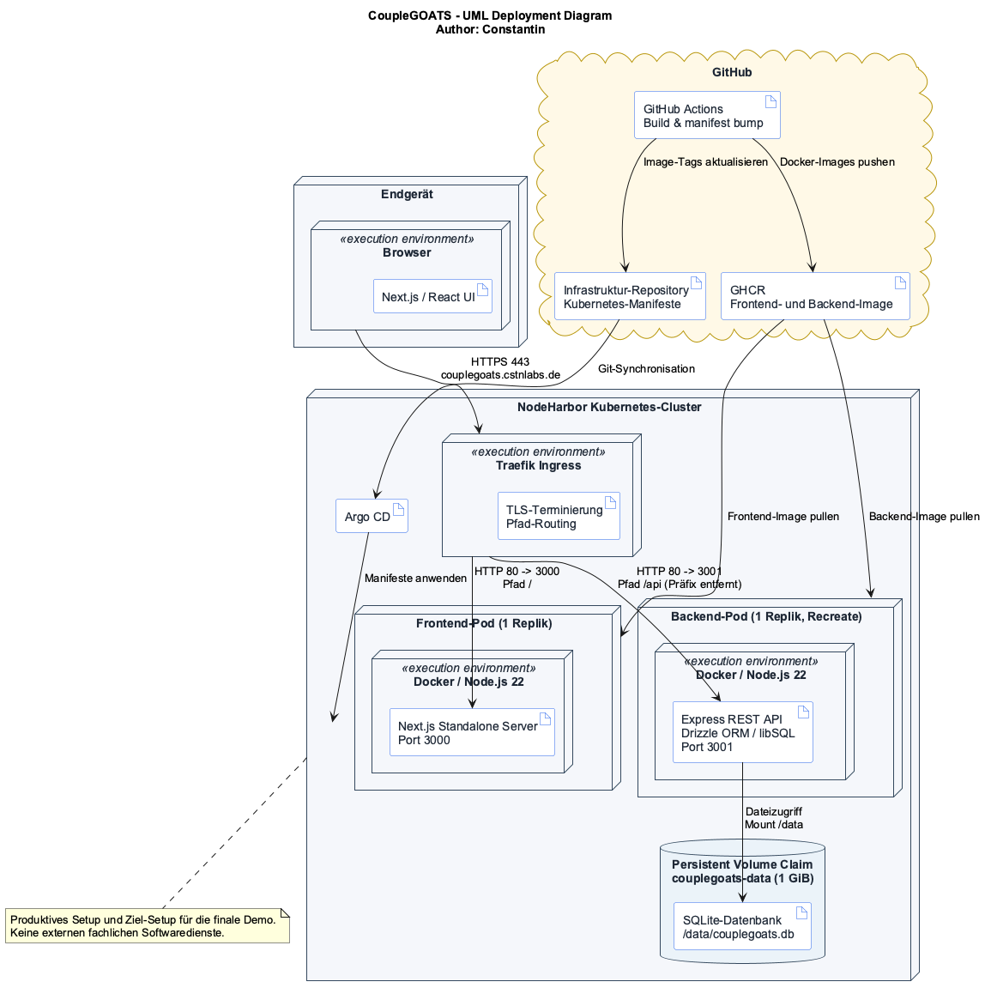

# CoupleGOATS — Softwarearchitekturdokument

<!--
HINWEISE ZUR VERWENDUNG
- Diese Datei liegt im Ordner docs/ des Repositories, neben SRS.md.
- Kommentare wie dieser sind Hinweise: Sie sind auf GitHub unsichtbar und dürfen gelöscht werden,
  sobald ein Abschnitt fertig ist.
- Jede Überschrift und ihre Nummer bleiben erhalten. Abschnitte, die auf eine spätere Vorlesung
  verweisen, bleiben bis dahin unverändert. Trifft ein Abschnitt nicht zu, steht dort
  „Nicht zutreffend“ und ein Satz zur Begründung.
- Jeder Abschnitt nennt seine Autorin oder seinen Autor: in der Zeile „Autor“ unter der Überschrift
  oder in der Spalte „Autor“ einer Tabelle.
- Jedes Diagramm liegt in docs/diagrams/, das Bild zusammen mit seiner Quelldatei.
- Struktur nach der RUP-Vorlage „Software Architecture Document“:
  https://cin.ufpe.br/~if682/RUP/webtmpl/templates/a_and_d/rup_sad.htm
-->

| Team | Version | Letzte Änderung |
| ---- | ------- | ----------- |
| CoupleGOATS | 0.1 | 30.10.2026 |

Die Git-Historie dieser Datei ist die Änderungshistorie.

## Inhaltsverzeichnis

1. [Einführung](#1-einführung)
2. [Architektonische Darstellung](#2-architektonische-darstellung)
3. [Architektonische Ziele und Einschränkungen](#3-architektonische-ziele-und-einschränkungen)
4. [Anwendungsfallsicht](#4-anwendungsfallsicht)
5. [Logische Sicht](#5-logische-sicht)
6. [Prozesssicht](#6-prozesssicht)
7. [Bereitstellungsansicht](#7-bereitstellungsansicht)
8. [Implementierungsansicht](#8-implementierungsansicht)
9. [Datenansicht](#9-datenansicht)
10. [Größe und Leistung](#10-größe-und-leistung)
11. [Qualität](#11-qualität)

## 1 Einführung

### 1.1 Zweck

*Autor: Mika*

<!-- Ein Absatz: Was dieses Dokument beschreibt und wer es liest – das Team, der Entwickelnde, der das Projekt übernimmt, und der Dozent als Investor. -->

Dieses Dokument beschreibt die Architektur der Webanwendung CoupleGOATS: aus welchen Teilen die Anwendung besteht, wie diese miteinander verbunden sind und wo sie laufen.

Es richtet sich an das Entwicklungsteam als gemeinsame Grundlage für Entwurfsentscheidungen, an Entwickelnde, die das Projekt später übernehmen und sich schnell einen Überblick über den Aufbau verschaffen müssen, sowie an den Dozenten als Investor, der die Architektur nachvollziehen und bewerten möchte. Die Anforderungen, aus denen sich die Architektur ableitet, stehen in der [SRS](SRS.md); dieses Dokument beschreibt, wie sie technisch umgesetzt werden.

### 1.2 Umfang

*Autor: Mika*

<!-- Ein bis zwei Sätze: Welche Software dieses Dokument abdeckt, z. B. die gesamte Anwendung mit Frontend, Backend und Datenbank. Der funktionale Umfang steht in SRS 1.2 – verlinken. -->

Dieses Dokument umfasst die gesamte Anwendung CoupleGOATS: das Frontend (Next.js), das Backend (Express) mit seiner REST-API und die SQLite-Datenbank, die gemeinsam im Monorepo unter `apps/frontend` und `apps/backend` liegen. Nicht Teil dieses Dokuments sind externe Softwaredienste, da die Anwendung derzeit keine nutzt (siehe [SRS 3.9.3](SRS.md#393-software-interfaces)). Der funktionale Umfang ist in [SRS 1.2](SRS.md#12-scope) beschrieben.

### 1.3 Begriffe, Abkürzungen und Kürzel

*Autor: Mika*

<!-- Begriffe der Fachdomäne stehen in der SRS und im Domänenmodell. Hier nur technische Begriffe ergänzen, die Leserinnen und Leser dieses Dokuments brauchen. -->

| Begriff | Bedeutung |
| ---- | ------- |
| SAD | Softwarearchitekturdokument |
| SRS | Softwareanforderungsspezifikation |
| UCR | Anwendungsfallrealisierung |
| UML | Unified Modeling Language, Notation für die Architekturdiagramme dieses Dokuments |
| REST | Representational State Transfer, Architekturstil der HTTP-Schnittstelle zwischen Frontend und Backend |
| JSON | JavaScript Object Notation, Datenformat, in dem Frontend und Backend Nutzdaten austauschen |
| HTTPS | HTTP über TLS, verschlüsselter Übertragungsweg zwischen Browser und Server |
| JWT | JSON Web Token, signiertes Token, mit dem sich ein angemeldetes Konto gegenüber geschützten Endpunkten ausweist |
| Next.js | React-Framework, mit dem das Frontend gebaut wird (App Router) |
| Express | Web-Framework für Node.js, auf dem das Backend und seine REST-API aufbauen |
| Zod | TypeScript-Bibliothek zur Validierung eingehender Anfragen im Backend |
| ORM | Object-Relational Mapping; im Projekt Drizzle ORM für Datenzugriff, Schema und Migrationen |
| SQLite / libSQL | Dateibasierte relationale Datenbank bzw. der Client, über den das Backend darauf zugreift |
| OpenAPI | Standardformat zur Beschreibung von REST-Schnittstellen, hier in `openapi.yaml` |
| Repository (Entwurfsmuster) | Klasse, die den Datenzugriff auf eine Datenbankentität kapselt; nicht zu verwechseln mit dem Git-Repository |
| Service | Backend-Klasse, die die fachliche Logik eines Anwendungsfalls enthält |
| Docker | Container-Technik, mit der Frontend und Backend als Images ausgeliefert werden |
| GitHub Actions | CI/CD-Dienst von GitHub, der bei jedem Push auf `main` die Docker-Images baut |
| Monorepo | Ein Git-Repository, das mehrere Anwendungen enthält, hier Frontend und Backend |

Begriffe der Fachdomäne stehen in [SRS 1.3](SRS.md#13-definitions-acronyms-and-abbreviations) und im [Domänenmodell](domain_model.md).

### 1.4 Referenzen

*Autor: Mika*

| Titel | Link |
| ----- | ---- |
| SRS | [SRS.md](SRS.md) |
| Domänenmodell | [domain_model.md](domain_model.md) |
| Repository | [ImConsti/CoupleGOATS](https://github.com/ImConsti/CoupleGOATS) |
| Board | [CoupleGoats Board](https://github.com/users/ImConsti/projects/1) |
| Laufende Anwendung | [couplegoats.cstnlabs.de](https://couplegoats.cstnlabs.de/) |
| Anwendungsfallrealisierungen | [use_case_realizations/](use_case_realizations/) |
| API-Endpunkte | [api-endpoints.md](api-endpoints.md) |
| OpenAPI-Spezifikation | [openapi.yaml](../apps/backend/openapi.yaml) |
| RUP-Vorlage SAD | [rup_sad.htm](https://cin.ufpe.br/~if682/RUP/webtmpl/templates/a_and_d/rup_sad.htm) |

### 1.5 Übersicht

Abschnitt 2 nennt die Sichten, die dieses Dokument verwendet. Die Abschnitte 3 bis 11 beschreiben die Architektur Sicht für Sicht, gemäß der RUP-Vorlage.

## 2 Architektonische Darstellung

*Autor: Mika*

<!-- Welche Sichten verwendet werden und welches Diagramm jede Sicht zeigt. Die Tabelle enthält vorab die Sichten aus Vorlesung 6 – anpassen, wenn eine Sicht ergänzt oder entfernt wird. Spätere Vorlesungen ergänzen hier Architekturstil und Architekturentscheidungen. -->

Die Architektur von CoupleGOATS wird in fünf Sichten beschrieben, die den Sichten der RUP-Vorlage entsprechen. Jede Sicht beantwortet eine eigene Frage und stützt sich auf die Diagramme, die das Team im Repository unter `docs/diagrams/` ablegt, jeweils als Bild zusammen mit seiner Quelldatei. Ein Paketdiagramm verwendet das Projekt nicht; die Aufteilung des Codes zeigt stattdessen das Komponentendiagramm. Die Prozesssicht wird durch eine Kurzbeschreibung abgedeckt. Die Sequenzdiagramme der Anwendungsfallrealisierungen ergänzen sie um den zeitlichen Ablauf einzelner Anwendungsfälle.

| Sicht | Beantwortete Frage | Diagramm | Abschnitt |
| ---- | ------------------- | ------- | ------- |
| Anwendungsfallsicht | Was leistet das System, und für wen? | [Anwendungsfalldiagramm](diagrams/use-case-diagram.png) ([Quelle](diagrams/use-case-diagram.puml)), [Anwendungsfallrealisierungen UCR-01 bis UCR-06](use_case_realizations/) | 4 |
| Logische Sicht | Welche Klassen gibt es, und wie hängen sie zusammen? | [Domänenmodell](diagrams/domain_model.png) ([Quelle](diagrams/domain_model.mmd)), Klassendiagramme der Realisierungen (`diagrams/UCR-01_classes.png` bis `diagrams/UCR-06_classes.png`) | 5 |
| Prozesssicht | Was läuft gleichzeitig ab? | Kurzbeschreibung; Sequenzdiagramme der Realisierungen (`diagrams/UCR-01_sequence_design.png` bis `diagrams/UCR-06_sequence_design.png`) | 6 |
| Bereitstellungsansicht | Was läuft wo, und wie ist es verbunden? | [Bereitstellungsdiagramm](diagrams/deployment.png) ([Quelle](diagrams/deployment.puml)) | 7 |
| Implementierungsansicht | Woraus besteht der Code? | [Komponentendiagramm](diagrams/components.png) ([Quelle](diagrams/components.puml)) | 8 |

### 2.1 Architekturstil

*Autor: Carolin*

<!-- Three short paragraphs, together rarely longer than half a page.
     Every reason names a scenario or a constraint from section 3 by its ID. -->

**Hauptstil.** 
Unser Backend ist ein Layered Monolith: ein einziger Node.js-Prozess (Express), der intern in die Schichten Controller, Services und Persistence (Repositories mit Drizzle ORM) aufgeteilt ist. 
Jede Schicht ruft nur die darunterliegende auf. 
Frontend (Next.js) und Backend bilden ein Client-Server-System: Der Browser fragt über die REST-API unter `/api/v1` an, das Backend antwortet mit JSON. 
Weitere Stile setzen wir nicht ein.

**Warum.** 
(1) Wir sind vier Personen un besuchen parallel weitere Vorlesungen (C-02): Ein Backend bedeutet nur einen Prozess, der gebaut, deployt und überwacht werden muss, und wenige Komponenten, die wir selbst warten müssen. 
(2) Die Daten liegen in einer SQLite-Datei (C-01), die nur ein Prozess gleichzeitig beschreiben darf. 
Deshalb läuft das Backend mit einer Instanz (siehe Abschnitt 7).
Das reicht auch für QS-02, da die Datei auf einem persistenten Volume liegt.
(3) Keines unserer Szenarien (QS-01 bis QS-03) braucht unabhängige Skalierung. QS-01 verlangt beispielsweise, dass die Suche bei bis zu 1.000 Datensätzen in 95% der Fälle unter 10 s antworten. 
Das schafft ein Prozess, in dem Service und Repository sich direkt aufrufen.

**Verworfene Alternative.** 
Microservices (z. B. je ein Dienst für Tiere, Matches und Termine). 
Sie würden uns unabhängiges Deployment und Skalieren ermöglichen. 
Wir haben sie nicht gewählt, weil Tiere, Matches und Termine eng zusammenhängen. 
Zudem bräuchte jeder Dienst eine eigene Datenbank, SQLite lässt jedoch nur eine Instanz zu (C-01). 
Des Weiteren können wir nicht mehrere Dienste betreiben, überwachen und deployen (C-02). 
Wir würden neu entscheiden, wenn die App deutschlandweit mit vielen Tierheimen läuft und einzelne Teile getrennt skaliert werden müssen.

### 2.2 Architecture decisions

*Author: [first name]*

<!-- One row per ADR in docs/decisions/. An accepted ADR is not rewritten: a new decision gets a
     new ADR, and the old one gets the status "superseded by ADR-xx". -->

| ADR    | Decision                                                  | Status     | Date         |
| ------ | --------------------------------------------------------- | ---------- | ------------ |
| ADR-01 | [[short title]](decisions/ADR-01_[short-title].md)         | [accepted] | [dd.mm.yyyy] |

## 3 Architektonische Ziele und Einschränkungen

### 3.1 Qualitätsszenarien
*Autor: Carolin*

| ID    | Qualität   | Verfeinerung   | Szenario, kurz                | Geschäftswert | Risiko | Autor       |
| ----- | --------- | ------------ | ------------------------------ | :---: | :--: | ------------ |
| QS-01 | Performance | Antwortzeit | Adoptierender stellt Suchanfrage → Ergebnisse in 95 % der Fälle innerhlab von 10 s | H  | M  | brdly06 |
| QS-02 | Zuverlässigkeit | Datenerhalt | Server wird neu gestartet → 100 % der Matches, Termine und Tierprofile sind vorhanden | H   | L  | Mika |
| QS-03 | Wartbarkeit | API-Dokumentation | Teammitglied ergänzt oder ändert Endpunkt → 100 % der Endpunkte sind in `openapi.yaml` dokumentiert | M   | M  | Constantin |

QS-01 kommt zuerst, weil es unter den Szenarien mit hohem Wert das höchste technische Risiko hat: Die Antwortzeit von 10 s muss auch bei bis zu 1.000 Datensätzen eingehalten werden, wodurch es entscheidend ist, wie Suche und Datenzugriff umgesetzt werden. 
QS-02 hat ebenfalls hohen Wert, ist aber durch das persistente Volume bereits gut abgesichert.

#### QS-01 Suchergebnisse innerhalb von 10 Sekunden

| QS-01 Suchergebnisse innerhalb von 10 Sekunden | *Autor: brdly06* · Konkretisiert [NFR-P-01](SRS.md#34-performance) |
| --- | --- |
| Quelle | Ein Adoptierender, der nach passenden Tieren sucht. |
| Auslöser | Der Adoptierende stellt über CoupleGOATS eine Suchanfrage. |
| Betroffenes Element | Die Komponente „Application Services“ des Backends aus dem [Komponentendiagramm](diagrams/components.png). |
| Umgebung | Normalbetrieb der Anwendung mit bis zu 1.000 gespeicherten Datensätzen. |
| Antwort | Die Anwendung zeigt dem Adoptierenden die zur Suchanfrage passenden Suchergebnisse an. |
| Antwortmaß | Die Suchergebnisse werden in mindestens **95 % der Fälle innerhalb von 10 Sekunden** angezeigt. |

Geschäftswert **H**: Eine schnelle Suche ermöglicht Adoptierenden, passende Tiere ohne lange Wartezeiten zu finden. Dadurch wird die zentrale Vermittlungsfunktion von CoupleGOATS unterstützt.
Technisches Risiko **M**: Die geforderte Antwortzeit muss auch bei bis zu 1.000 gespeicherten Datensätzen zuverlässig eingehalten werden. Dafür müssen Suchverarbeitung und Datenzugriff ausreichend performant sein.

#### QS-02 Datenerhalt bei Serverneustart

| QS-02 Datenerhalt bei Serverneustart | *Autor: Mika* · Konkretisiert [NFR-R-01](SRS.md#33-reliability) |
| --- | --- |
| Quelle | Betreiberin oder Betreiber der Anwendung. |
| Auslöser | Der Server wird neu gestartet, z. B. für ein Update, während Adoptierende und Tierheime bereits Matches und Meet-&-greet-Termine gespeichert haben. |
| Betroffenes Element | Die Komponenten „Persistence“ und „SQLite Database“ aus dem [Komponentendiagramm](diagrams/components.png). |
| Umgebung | Normalbetrieb im Produktivsystem; der Neustart erfolgt regulär oder durch einen Absturz des Backends, nicht durch einen Defekt des Datenträgers. |
| Antwort | Alle vor dem Neustart bestätigten Daten sind nach dem Neustart unverändert abrufbar. |
| Antwortmaß | **100 %** der vor dem Neustart bestätigten Matches, Termine und Tierprofile sind nach dem Neustart vorhanden (**0** verlorene Datensätze). |

Geschäftswert **H**: Verlorene Matches oder Termine zerstören das Vertrauen von Adoptierenden und Tierheimen, und das Meet & greet ist der Kern des Nutzens.
Technisches Risiko **L**: Die Daten liegen auf einem persistenten Volume und überleben den Neustart, das Risiko besteht nur bei einem Absturz mitten in einem Schreibvorgang.

#### QS-03 Vollständigkeit der API-Dokumentation

| QS-03 Vollständigkeit der API-Dokumentation | *Autor: Constantin* · Konkretisiert [NFR-S-01](SRS.md#35-supportability) |
| ------------------------------------------ | --------------------------------------------------------------- |
| Quelle | Ein Mitglied des Backend-Teams, das einen REST-Endpunkt ergänzt oder ändert. |
| Auslöser | Das Teammitglied stellt die Änderung des Endpunkts zur Integration bereit. |
| Betroffenes Element | Die Komponente „API & Auth“ des Backends aus dem [Komponentendiagramm](diagrams/components.png). |
| Umgebung | Laufende Entwicklung; die Änderung wird vor der Integration mit der API-Spezifikation abgeglichen. |
| Antwort | Das Team dokumentiert den Endpunkt mit Methode, Pfad und relevantem Anfrage- und Antwortverhalten in der API-Spezifikation und gleicht die Spezifikation mit den implementierten Routen ab. |
| Antwortmaß | Beim Abgleich sind **100 %** der implementierten REST-Endpunkte in `openapi.yaml` dokumentiert. |

Geschäftswert **M**: Eine vollständige Schnittstellenbeschreibung erleichtert die Zusammenarbeit zwischen Frontend und Backend sowie spätere Änderungen. Technisches Risiko **M**: Bei Änderungen an Routen und deren Verhalten kann die Dokumentation ohne konsequenten Abgleich veralten.

### 3.2 Einschränkungen

*Autor: Carolin*

| ID   | Art           | Einschränkungen                               | Bedeutung für unsere Architektur |
| ---- | -------------- | ---------------------------------------- | ---------------------------------- |
| C-01 | Technisch      | Frontend mit Next.js (React), Backend mit Express, beides in TypeScript, SQLite als Datenbank.  Details in [SRS 3.6](SRS.md#36-design-constraints) | Das Frontend ist eine eigene Next.js-Anwendung und spricht das Backend über die REST-API an.  Da wir SQLite nutzen, betreiben wir das Backend bewusst mit nur einer Instanz. |
| C-02 | Organisatorisch | Vier Teammitglieder, parallel weitere Vorlesungen, Zeit bis zum Ende des vierten Semesters                        | Wenige Komponenten, nur das was wir selbst warten können, Fokus auf die wichtigsten Anwendungsfälle.                    |
| C-03 | Wirtschaftlich       | kein Budget, nur freie Open-Source-Bibliotheken ([SRS 3.8](SRS.md#38-purchased-components))                      | Wir nutzen nur kostenlose Open-Source-Bibliotheken und keine kostenpflichtigen Dienste. Dadurch läuft alles im eigenen Backend, E-Mail-Benachrichtigungen gibt es vorerst nicht.                    |
| C-04 | Rechtlich        | Wir speichern personenbezogene Daten (Name, E-Mail-Adresse, Profilangaben, Termine), siehe [SRS 3.11](SRS.md#311-legal-copyright-and-other-notices)                         | Wir achten auf grundlegende Datenschutzprinzipien wie Datenminimierung und sichere Speicherung.  Personenbezogene Daten sind nur für berechtigte Konten sichtbar.                      |

<!-- Vorlesung 7. Die Anforderungen und Einschränkungen, die die Architektur prägen: Qualitätsziele wie Verfügbarkeit oder Sicherheit sowie Einschränkungen wie Technologiestack (SRS 3.6), Teamgröße oder Zeitplan. Bis dahin unverändert lassen. -->

## 4 Anwendungsfallsicht

*Autor: Carolin*

Das Anwendungsfalldiagramm der gesamten Anwendung ist in [SRS 2.2](SRS.md#22-use-case-diagram).

Für die Architektur sind folgende Anwendungsfälle am wichtigsten:
- Swipe (UC-01): durchläuft Frontend, API und Datenbank und erzeugt über den Like den Match-Zustand, der das Meet & greet ermöglicht.
- Tierprofile mit Tags verwalten (UC-03): erfordert die Rechteprüfung (nur das eigene Tierheim darf bearbeiten) und bildet eine n:m-Beziehung zwischen Tier und Tag ab.
- Meet & greet (UC-04): betrifft Adoptierende und Tierheime mit jeweils eigener Ansichten und hat Zustände (angefragt, bestätigt, abgesagt).

### 4.1 Anwendungsfallrealisierungen

| Anwendungsfall | Realisierung | Autor |
| -------------- | ------------ | ----- |
| [UC-01 Tiere swipen](use_cases/UC-01_swipe.md) | [UCR-01](use_case_realizations/UCR-01_swipe.md) | Mika |
| [UC-02 Tierprofil ansehen](use_cases/UC-02_animal_detail.md) | [UCR-02](use_case_realizations/UCR-02_animal_detail.md) | Aaron |
| [UC-03 Tierprofil verwalten](use_cases/UC-03_manage_animal.md) | [UCR-03](use_case_realizations/UCR-03_manage_animal.md) | Aaron |
| [UC-04 Meet & Greet buchen](use_cases/UC-04_meet_and_greet.md) | [UCR-04](use_case_realizations/UCR-04_meet_and_greet.md) | Constantin |
| [UC-05 Nutzerprofil verwalten](use_cases/UC-05_manage_profile.md) | [UCR-05](use_case_realizations/UCR-05_manage_profile.md) | Constantin |
| [UC-06 Tierheim Dashboard ansehen](use_cases/UC-06_shelter_dashboard.md) | [UCR-06](use_case_realizations/UCR-06_shelter_dashboard.md) | Carolin |

## 5 Logische Sicht

### 5.1 Überblick

*Autor: Carolin*

<!-- Domänenmodell aus Aufgabe 5 verlinken. Gibt es ein Paketdiagramm, steht es hier: die Pakete des Codes und ihre Abhängigkeiten, ohne Zyklen. -->

Das Domänenmodell ist in [domain_model.md](domain_model.md).

### 5.2 Architekturrelevante Entwurfspakete

Die Entwurfsklassen sind in Abschnitt 2.5 der jeweiligen Anwendungsfallrealisierung zu finden:
- [Entwurfsklassen UCR-01](use_case_realizations/UCR-01_swipe.md#25-design-classes) (Autor: Mika)
- [Entwurfsklassen UCR-02](use_case_realizations/UCR-02_animal_detail.md#25-design-classes) (Autor: brdly06)
- [Entwurfsklassen UCR-03](use_case_realizations/UCR-03_manage_animal.md#25-design-classes) (Autor: brdly06)
- [Entwurfsklassen UCR-04](use_case_realizations/UCR-04_meet_and_greet.md#25-design-klassen) (Autor: Constantin)
- [Entwurfsklassen UCR-05](use_case_realizations/UCR-05_manage_profile.md#25-design-klassen) (Autor: Constantin)
- [Entwurfsklassen UCR-06](use_case_realizations/UCR-06_shelter_dashboard.md#25-design-classes) (Autor: Carolin)

## 6 Prozesssicht

*Autor: Carolin*

Zur Laufzeit gibt es das Frontend (Next.js) und das Backend (Node.js mit Express, Einbindung der SQLite-DB), das Frontend ruft das Backend über die REST-API auf. 
Hintergrundprozesse oder zeitgesteuerte Jobs gibt es derzeit nicht.

## 7 Bereitstellungsansicht

*Autor: Constantin*

Das Diagramm zeigt die aktuell produktiv eingesetzte und für die finale Demo vorgesehene
Bereitstellung unter `https://couplegoats.cstnlabs.de`. Ein Endgerät greift per HTTPS auf den
Traefik-Ingress des Kubernetes-Clusters zu. Traefik terminiert TLS und leitet Anfragen an `/`
zum Frontend-Service sowie Anfragen an `/api` zum Backend-Service weiter; beim Backend wird
das Präfix `/api` vor der Weiterleitung entfernt.

Frontend und Backend laufen jeweils als einzelner Docker-Container in einem eigenen Pod. Der
Next.js-Standalone-Server lauscht auf Port 3000, die Express-API auf Port 3001. Das Backend
greift über Drizzle ORM und den libSQL-Client auf die SQLite-Datei
`/data/couplegoats.db` zu. Diese liegt auf einem persistenten Kubernetes-Volume und bleibt
damit bei einem Neustart oder Austausch des Backend-Pods erhalten. Da SQLite nur von einer
Backend-Instanz verwendet werden soll, läuft das Backend mit einer Replik und der
Bereitstellungsstrategie `Recreate`.

Bei einem Push auf `main` baut GitHub Actions beide Docker-Images und legt sie in der GitHub
Container Registry (GHCR) ab. Anschließend aktualisiert die Pipeline die Image-Tags im
Infrastruktur-Repository; Argo CD synchronisiert die Kubernetes-Manifeste mit dem Cluster.
GHCR, GitHub Actions und Argo CD gehören damit zum Auslieferungsweg, nicht zur Laufzeitkommunikation
zwischen Browser, Frontend und Backend. Externe fachliche Softwaredienste werden gemäß
[SRS 3.9.3](SRS.md#393-software-interfaces) nicht verwendet.

| Knoten | Was dort läuft | Verbunden mit |
| ------ | -------------- | ------------- |
| Endgerät | Browser mit ausgeliefertem Next.js-/React-Frontend | Traefik-Ingress: HTTPS 443 |
| Kubernetes-Cluster | Traefik-Ingress mit TLS-Terminierung und Routing | Browser: HTTPS 443; Frontend- und Backend-Service: HTTP 80 |
| Frontend-Pod | Docker-Container mit Node.js 22 und Next.js-Standalone-Server | Frontend-Service: HTTP 3000 |
| Backend-Pod | Docker-Container mit Node.js 22, Express-API, Drizzle ORM und libSQL-Client | Backend-Service: HTTP 3001; persistentes Volume: Dateizugriff |
| Persistentes Volume | SQLite-Datei `/data/couplegoats.db` mit Schema und Anwendungsdaten | Backend-Pod: gemountet unter `/data` |
| GitHub-Infrastruktur | GitHub Actions, GHCR und Infrastruktur-Repository | Argo CD: Image- und Manifest-Aktualisierung |

## 8 Implementierungsansicht

### 8.1 Übersicht

*Autor: brdly06*

Das Komponentendiagramm zeigt die Architektur der Webanwendung CoupleGOATS mit Frontend, Backend, Datenbank und den wesentlichen Backend-Komponenten. Es basiert auf den technischen Vorgaben aus SRS 3.6, den Software-Schnittstellen aus SRS 3.9.3 sowie den Entwurfsklassen aus Aufgabe 5.

Das Frontend basiert auf Next.js, React und TypeScript. Es kommuniziert über die REST-API unter `/api/v1` mit dem Backend. Die Kommunikation erfolgt über HTTPS; die Nutzdaten werden im JSON-Format übertragen. Datei-Uploads verwenden `multipart/form-data`.

Das Backend basiert auf Node.js und Express. Es ist in API und Authentifizierung, fachliche Services, Persistence sowie Medienverarbeitung unterteilt. Die API-Komponente verarbeitet Anfragen und delegiert die fachliche Verarbeitung an die Services. Diese verwenden Repositories für den Datenzugriff und die Medienkomponente für die Verwaltung von Tierbildern.

Die Persistence-Komponente verwendet Drizzle ORM und den libSQL-Client, um auf die SQLite-Datenbank zuzugreifen. Gemäß SRS 3.9.3 werden die Daten einschließlich der Bilder in einer SQLite-Datei gespeichert. Das Frontend greift nicht direkt auf die Datenbank zu.

Laut SRS 3.9.3 sind derzeit keine externen Softwaredienste vorgesehen. Ein externer E-Mail-Dienst wird lediglich als mögliche spätere Erweiterung erwähnt und ist deshalb nicht als bestehende Komponente dargestellt.

Die Komponenten und ihre Verantwortlichkeiten sind in der folgenden Tabelle zusammengefasst. Die zugeordneten Klassen stammen aus den Entwurfsklassendiagrammen von Aufgabe 5. Die Zuordnung beschreibt die vorgesehene Architektur und bestätigt nicht, dass diese Klassen bereits implementiert sind.

| Komponente | Verantwortung | Klassen (Aufgabe 5) |
|---|---|---|
| Frontend | Benutzeroberfläche für Discovery, Tierdetails, Profilverwaltung, Matches, Terminverwaltung und Tierheim-Dashboard | DiscoveryPage, ShelterDashboardPage |
| API & Auth | REST-Endpunkte, Anfragevalidierung, Authentifizierung und Autorisierung | DiscoveryController, AnimalDetailController, AnimalProfileController, UserInterestsRouter, ShelterInterestsRouter, UsersRouter, ShelterDashboardController, authenticationHandler, roleHandler, zodValidation, errorHandler |
| Application Services | Fachliche Logik für Discovery, Tierprofile, Interessen, Termine, Nutzerprofile und Dashboard | DiscoveryService, AnimalDetailService, AnimalProfileService, InterestService, UserService, ShelterDashboardService |
| Persistence | Datenzugriff und Speicherung über Repositories und Drizzle ORM | AnimalRepository, AnimalPictureRepository, AnimalShelterRepository, InterestRepository, UserRepository, UserFilterRepository |
| Media Handling | Verarbeitung und Verwaltung hochgeladener Tier- und Profilbilder | PhotoStorageService |
| SQLite Database | Persistente Speicherung von Nutzern, Tierprofilen, Interessen, Terminen und Bildern | Animal, AnimalPicture, AnimalShelter, Interest, User, UserFilter |

Die REST-API ist die Schnittstelle zwischen Frontend und Backend. Die Datenbank wird ausschließlich über die Persistence-Komponente angesprochen. Die interne Aufteilung unterstützt die Trennung von Benutzeroberfläche, fachlicher Logik und Datenzugriff.

### 8.2 Schichtenarchitektur (Backend-Schichtenarchitektur und Code-Check)

*Autor: brdly06*

| Schicht | Ordner | Inhalt | Darf verwenden |
| --- | --- | --- | --- |
| HTTP / Controller | `src/router/` | Express-Routen, Request-/Response-Verarbeitung und Aufruf der Anwendungsfälle | `services/`, `middleware/`, `validation/`, `errors/`, `types.ts` sowie Express |
| Middleware | `src/middleware/` | Authentifizierung, Rollenprüfung und Fehler-/404-Behandlung | `services/`, `utils/`, `errors/`, `types.ts` sowie Express |
| Validierung | `src/validation/` | Zod-Schemas und Validierungs-Hilfsfunktionen | Zod, `errors/` und gemeinsame Typen |
| Anwendung / Services | `src/services/` | Anwendungsfälle und Geschäftsregeln | `repositories/`, `errors/`, `utils/` und `types.ts` |
| Persistenz / Repository | `src/repositories/` | Datenbankabfragen und Repository-Funktionen | `db/`, `errors/` und `types.ts` |
| Datenbank | `src/db/` sowie `drizzle/` | Drizzle-Verbindung, Schema, Relationen und SQL-Migrationen | Datenbank-/Drizzle-Bibliotheken; innerhalb der Anwendung keine höheren Schichten |
| Gemeinsame Hilfsfunktionen | `src/errors/`, `src/utils/`, `src/types.ts` | Fehlerklassen/-mapping, technische Hilfsfunktionen und gemeinsam verwendete Typen | Externe Bibliotheken und niedrigere technische Typdefinitionen; keine Router-, Service- oder Repository-Aufrufe |

Das Backend ist als modularer Monolith organisiert. In der vorliegenden Ordnerstruktur sind keine getrennten fachlichen Module mit eigenen Modulgrenzen erkennbar.

**Im Code geprüft.** Wir haben den Anwendungsfall „Rassen einer Tierart abrufen“ verfolgt: `src/router/speciesController.ts` (Zeilen 22–29) → `src/services/breedService.ts` (Zeilen 6–12) → `src/repositories/breedRepository.ts` (Zeilen 5–18). Der geprüfte Hauptpfad hält die Schichtenfolge ein: Der Controller ruft den Service auf und der Service das Repository. Bei der Prüfung weiterer Imports fanden wir jedoch Abweichungen von den Regeln: `src/middleware/authenticationHandler.ts` verwendet die Repositories direkt (Zeilen 4–5), `src/services/animalProfileService.ts` greift direkt auf die Datenbank zu (Zeile 15) und `src/services/tagService.ts` importiert ein Validierungs-Schema (Zeile 2). Diese Abweichungen sind dokumentiert und werden im Rahmen dieses Issues nicht behoben.

## 9 Datenansicht

<!-- Vorerst optional. Später: Datenbankschema oder ER-Modell, abgeleitet aus dem Domänenmodell. -->

*Folgt später.*

## 10 Größe und Leistung

<!-- Vorlesung 7. Die Zahlen, die die Architektur prägen, z. B. erwartete Nutzende und Daten sowie die Leistungsanforderungen aus SRS 3.4. Bis dahin unverändert lassen. -->

*Folgt mit Vorlesung 7.*

## 11 Quality

*Author: [first name]*

<!-- One row per scenario from section 3.1. One or two tactics per scenario.
     Where: a component from 8.1 or a layer from 8.2. Status: in place, planned or not planned.
     Price: one short phrase — every tactic costs something. Decision: the ADR, if there is one. -->

How our architecture reaches the scenarios of section 3.1:

| Scenario      | Tactics   | Where       | Status   | Price   | Decision |
| ------------- | --------- | ----------- | -------- | ------- | -------- |
| QS-01 [name]  | [tactic]  | [component] | [status] | [price] | [— or ADR-xx] |
| QS-02 [name]  | [tactic]  | [component] | [status] | [price] | [— or ADR-xx] |
| QS-03 [name]  | [tactic]  | [component] | [status] | [price] | [— or ADR-xx] |

[Two or three sentences on your highest-rated scenario: why these tactics, and which alternative
you did not take. If a tactic is "not planned", say why in one sentence.]
