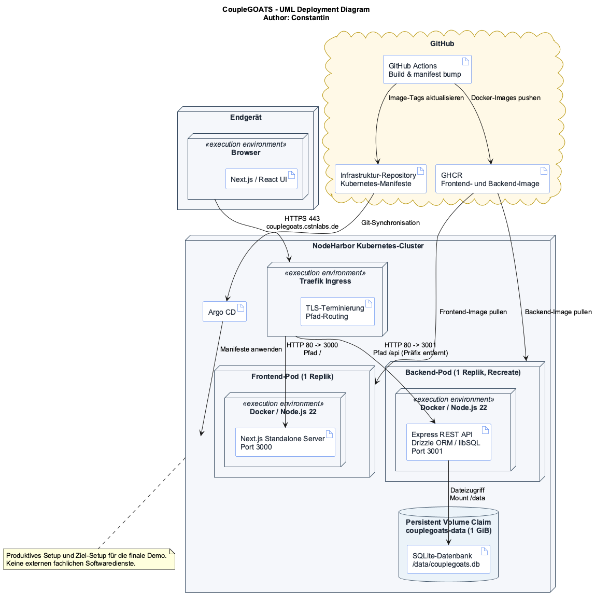

# CoupleGOATS — Software Architektur Dokument

<!--
HOW TO USE THIS TEMPLATE
- Copy this file into the docs/ folder of your repository, next to SRS.md.
- Replace every [placeholder] in square brackets. Comments like this one are guidance: they
  are invisible on GitHub, and you may delete them once a section is done.
- Keep every heading and its number. Sections marked "Lecture 7" or later stay as they are
  until that lecture. If a section does not apply, write "Not applicable" and one sentence why.
- Every section you write names its author: in the "Author" line below its heading, or in
  the Author column of a table.
- Put every diagram into docs/diagrams/, the image together with its source file.
- Structure after the RUP template "Software Architecture Document":
  https://cin.ufpe.br/~if682/RUP/webtmpl/templates/a_and_d/rup_sad.htm
-->

| Team | Version | Letzte Änderung |
| ---- | ------- | ----------- |
| CoupleGOATS | 0.1 | 30.10.2026 |

The Git history of this file is the revision history.

## Inhaltsverzeichnis

1. [Introduction](#1-introduction)
2. [Architectural representation](#2-architectural-representation)
3. [Architectural goals and constraints](#3-architectural-goals-and-constraints)
4. [Use-Case Sicht](#4-use-case-sicht)
5. [Logische Sicht](#5-logische-sicht)
6. [Prozesssicht](#6-prozesssicht)
7. [Deployment view](#7-deployment-view)
8. [Implementation view](#8-implementation-view)
9. [Data view](#9-data-view)
10. [Size and performance](#10-size-and-performance)
11. [Quality](#11-quality)

## 1 Einführung

### 1.1 Zweck

*Author: Mika*

<!-- One paragraph: what this document describes and who reads it — your team, the developer
     who takes the project over, and the lecturer as investor. -->

Dieses Dokument beschreibt die Architektur der Webanwendung CoupleGOATS: aus welchen Teilen die Anwendung besteht, wie diese miteinander verbunden sind und wo sie laufen.

Es richtet sich an das Entwicklungsteam als gemeinsame Grundlage für Entwurfsentscheidungen, an Entwickelnde, die das Projekt später übernehmen und sich schnell einen Überblick über den Aufbau verschaffen müssen, sowie an den Dozenten als Investor, der die Architektur nachvollziehen und bewerten möchte. Die Anforderungen, aus denen sich die Architektur ableitet, stehen in der [SRS](SRS.md); dieses Dokument beschreibt, wie sie technisch umgesetzt werden.

### 1.2 Scope

*Author: Mika*

<!-- One or two sentences: which software this document covers, e.g., the whole application
     with frontend, backend, and database. The functional scope is in SRS 1.2 — link it. -->

Dieses Dokument umfasst die gesamte Anwendung CoupleGOATS: das Frontend (Next.js), das Backend (Express) mit seiner REST-API und die SQLite-Datenbank, die gemeinsam im Monorepo unter `apps/frontend` und `apps/backend` liegen. Nicht Teil dieses Dokuments sind externe Softwaredienste, da die Anwendung derzeit keine nutzt (siehe [SRS 3.9.3](SRS.md#393-software-interfaces)). Der funktionale Umfang ist in [SRS 1.2](SRS.md#12-scope) beschrieben.

### 1.3 Begriffe, Abkürzungen und Kürzel

*Author: Mika*

<!-- Terms of the domain are in the SRS and in your domain model. Add only the technical terms
     a reader of this document needs. -->

| Term | Meaning |
| ---- | ------- |
| SAD | Software Architecture Document |
| SRS | Software Requirements Specification |
| UCR | Use-case realization |
| UML | Unified Modeling Language, Notation für die Architekturdiagramme dieses Dokuments |
| REST | Representational State Transfer, Architekturstil der HTTP-Schnittstelle zwischen Frontend und Backend |
| JSON | JavaScript Object Notation, Datenformat, in dem Frontend und Backend Nutzdaten austauschen |
| HTTPS | HTTP über TLS, verschlüsselter Übertragungsweg zwischen Browser und Server |
| JWT | JSON Web Token, signiertes Token, mit dem sich ein angemeldetes Konto gegenüber geschützten Endpunkten ausweist |
| Next.js | React-Framework, mit dem das Frontend gebaut wird (App Router) |
| Express | Web-Framework für Node.js, auf dem das Backend und seine REST-API aufbauen |
| Zod | TypeScript-Bibliothek zur Validierung eingehender Anfragen im Backend |
| ORM | Object-Relational Mapping; im Projekt Drizzle ORM für Datenzugriff, Schema und Migrationen |
| SQLite / libSQL | Dateibasierte relationale Datenbank bzw. der Client, über den das Backend darauf zugreift |
| OpenAPI | Standardformat zur Beschreibung von REST-Schnittstellen, hier in `openapi.yaml` |
| Repository (Entwurfsmuster) | Klasse, die den Datenzugriff auf eine Datenbankentität kapselt; nicht zu verwechseln mit dem Git-Repository |
| Service | Backend-Klasse, die die fachliche Logik eines Anwendungsfalls enthält |
| Docker | Container-Technik, mit der Frontend und Backend als Images ausgeliefert werden |
| GitHub Actions | CI/CD-Dienst von GitHub, der bei jedem Push auf `main` die Docker-Images baut |
| Monorepo | Ein Git-Repository, das mehrere Anwendungen enthält, hier Frontend und Backend |

Begriffe der Fachdomäne stehen in [SRS 1.3](SRS.md#13-definitions-acronyms-and-abbreviations) und im [Domain model](domain_model.md).

### 1.4 Referenzen

*Author: Mika*

| Title | Link |
| ----- | ---- |
| SRS | [SRS.md](SRS.md) |
| Domain model | [domain_model.md](domain_model.md) |
| Repository | [ImConsti/CoupleGOATS](https://github.com/ImConsti/CoupleGOATS) |
| Board | [CoupleGoats Board](https://github.com/users/ImConsti/projects/1) |
| Laufende Anwendung | [couplegoats.cstnlabs.de](https://couplegoats.cstnlabs.de/) |
| Use-Case-Realisierungen | [use_case_realizations/](use_case_realizations/) |
| API-Endpunkte | [api-endpoints.md](api-endpoints.md) |
| OpenAPI-Spezifikation | [openapi.yaml](../apps/backend/openapi.yaml) |
| RUP-Vorlage SAD | [rup_sad.htm](https://cin.ufpe.br/~if682/RUP/webtmpl/templates/a_and_d/rup_sad.htm) |

### 1.5 Übersicht

Section 2 names the views this document uses. Sections 3 to 11 describe the architecture view
by view, following the RUP template.

## 2 Architektonische Darstellung

*Author: Mika*

<!-- Which views you use and which diagram shows each. The table is prefilled with the views of
     Lecture 6 — adjust it if you add or drop a view. Later lectures add your architectural
     style and your architecture decisions here. -->

Die Architektur von CoupleGOATS wird in fünf Sichten beschrieben, die den Sichten der RUP-Vorlage entsprechen. Jede Sicht beantwortet eine eigene Frage und stützt sich auf die Diagramme, die das Team im Repository unter `docs/diagrams/` ablegt, jeweils als Bild zusammen mit seiner Quelldatei. Ein Paketdiagramm verwendet das Projekt nicht; die Aufteilung des Codes zeigt stattdessen das Komponentendiagramm. Die Process view wird durch eine Kurzbeschreibung abgedeckt. Die Sequenzdiagramme der Use-Case-Realisierungen ergänzen sie um den zeitlichen Ablauf einzelner Anwendungsfälle.

| View | Question it answers | Diagram | Section |
| ---- | ------------------- | ------- | ------- |
| Use-case view | Was leistet das System, und für wen? | [Use-Case-Diagramm](diagrams/use-case-diagram.png) ([Quelle](diagrams/use-case-diagram.puml)), [Use-Case-Realisierungen UCR-01 bis UCR-06](use_case_realizations/) | 4 |
| Logical view | Welche Klassen gibt es, und wie hängen sie zusammen? | [Domain model](diagrams/domain_model.png) ([Quelle](diagrams/domain_model.mmd)), Klassendiagramme der Realisierungen (`diagrams/UCR-01_classes.png` bis `diagrams/UCR-06_classes.png`) | 5 |
| Process view | Was läuft gleichzeitig ab? | Kurzbeschreibung; Sequenzdiagramme der Realisierungen (`diagrams/UCR-01_sequence_design.png` bis `diagrams/UCR-06_sequence_design.png`) | 6 |
| Deployment view | Was läuft wo, und wie ist es verbunden? | [Deployment-Diagramm](diagrams/deployment.png) ([Quelle](diagrams/deployment.puml)) | 7 |
| Implementation view | Woraus besteht der Code? | [Komponentendiagramm](diagrams/components.png) ([Quelle](diagrams/components.puml)) | 8 |

## 3 Architektonische Ziele und Einschränkungen

<!-- Lecture 7. The requirements and constraints that shape your architecture: quality goals
     such as availability or security, and constraints such as your stack (SRS 3.6), your team
     size, or your schedule. Leave this section as it is until then. -->

*Follows with Lecture 7.*

## 4 Use-Case Sicht

*Author: Carolin*

Das Use-Case-Diagramm der gesamten Anwendung ist in [SRS 2.2](SRS.md#22-use-case-diagram).

Für die Architektur sind folgende Use Cases am wichtigsten:
- Swipe (UC-01): durchläuft Frontend, API und Datenbank und erzeugt über den Like den Match-Zustand, der das Meet & greet ermöglicht.
- Tierprofile mit Tags verwalten (UC-03): erfordert die Rechteprüfung (nur das eigene Tierheim darf bearbeiten) und bildet eine n:m-Beziehung zwischen Tier und Tag ab.
- Meet & greet (UC-04): betrifft Adoptierende und Tierheime mit jeweils eigener Ansichten und hat Zustände (angefragt, bestätigt, abgesagt).

### 4.1 Use-Case Realisierungen

| Use case | Realization | Author |
| -------- | ----------- | ------ |
| [UC-01 Tiere swipen](use_cases/UC-01_swipe.md) | [UCR-01](use_case_realizations/UCR-01_swipe.md) | Mika |
| [UC-02 Tierprofil ansehen](use_cases/UC-02_animal_detail.md) | [UCR-02](use_case_realizations/UCR-02_animal_detail.md) | Aaron |
| [UC-03 Tierprofil verwalten](use_cases/UC-03_manage_animal.md) | [UCR-03](use_case_realizations/UCR-03_manage_animal.md) | Aaron |
| [UC-04 Meet & Greet buchen](use_cases/UC-04_meet_and_greet.md) | [UCR-04](use_case_realizations/UCR-04_meet_and_greet.md) | Constantin |
| [UC-05 Nutzerprofil verwalten](use_cases/UC-05_manage_profile.md) | [UCR-05](use_case_realizations/UCR-05_manage_profile.md) | Constantin |
| [UC-06 Tierheim Dashboard ansehen](use_cases/UC-06_shelter_dashboard.md) | [UCR-06](use_case_realizations/UCR-06_shelter_dashboard.md) | Carolin |

## 5 Logische Sicht

### 5.1 Überblick

*Author: Carolin*

<!-- Link your domain model from Task 5. If you have a package diagram, put it here: the
     packages of your code and their dependencies, without cycles. -->

Das Domain-Model ist in [domain_model.md](domain_model.md).

### 5.2 Architekturrelevante Design-Pakete

Die Designklassen sind in Abschnitt 2.5 der jeweiligen Use-Case-Realisierung zu finden:
- [Design Klassen UCR-01](use_case_realizations/UCR-01_swipe.md#25-design-classes) (Autor: Mika)
- [Design Klassen UCR-02](use_case_realizations/UCR-02_animal_detail.md#25-design-classes) (Autor: Aaron)
- [Design Klassen UCR-03](use_case_realizations/UCR-03_manage_animal.md#25-design-classes) (Autor: Aaron)
- [Design Klassen UCR-04](use_case_realizations/UCR-04_meet_and_greet.md#25-design-klassen) (Autor: Constantin)
- [Design Klassen UCR-05](use_case_realizations/UCR-05_manage_profile.md#25-design-klassen) (Autor: Constantin)
- [Design Klassen UCR-06](use_case_realizations/UCR-06_shelter_dashboard.md#25-design-classes) (Autor: Carolin)

## 6 Prozesssicht

*Author: Carolin*

Zur Laufzeit gibt es das Frontend (Next.js) und das Backend (Node.js mit Express, Einbindung der SQLite-DB), das Frontend ruft das Backend über die REST-API auf. 
Hintergrundprozesse oder zeitgesteuerte Jobs gibt es derzeit nicht.

## 7 Bereitstellungsansicht

*Author: Constantin*

Das Diagramm zeigt das aktuell produktiv eingesetzte und für die finale Demo vorgesehene
Deployment unter `https://couplegoats.cstnlabs.de`. Ein Endgerät greift per HTTPS auf den
Traefik-Ingress des Kubernetes-Clusters zu. Traefik terminiert TLS und leitet Anfragen an `/`
zum Frontend-Service sowie Anfragen an `/api` zum Backend-Service weiter; beim Backend wird
das Präfix `/api` vor der Weiterleitung entfernt.

Frontend und Backend laufen jeweils als einzelner Docker-Container in einem eigenen Pod. Der
Next.js-Standalone-Server lauscht auf Port 3000, die Express-API auf Port 3001. Das Backend
greift über Drizzle ORM und den libSQL-Client auf die SQLite-Datei
`/data/couplegoats.db` zu. Diese liegt auf einem persistenten Kubernetes-Volume und bleibt
damit bei einem Neustart oder Austausch des Backend-Pods erhalten. Da SQLite nur von einer
Backend-Instanz verwendet werden soll, läuft das Backend mit einer Replik und der
Deployment-Strategie `Recreate`.

Bei einem Push auf `main` baut GitHub Actions beide Docker-Images und legt sie in der GitHub
Container Registry (GHCR) ab. Anschließend aktualisiert die Pipeline die Image-Tags im
Infrastruktur-Repository; Argo CD synchronisiert die Kubernetes-Manifeste mit dem Cluster.
GHCR, GitHub Actions und Argo CD gehören damit zum Auslieferungsweg, nicht zur Laufzeitkommunikation
zwischen Browser, Frontend und Backend. Externe fachliche Softwaredienste werden gemäß
[SRS 3.9.3](SRS.md#393-software-interfaces) nicht verwendet.

| Node | What runs there | Connected to |
| ---- | --------------- | ------------ |
| Endgerät | Browser mit ausgeliefertem Next.js-/React-Frontend | Traefik-Ingress: HTTPS 443 |
| Kubernetes-Cluster | Traefik-Ingress mit TLS-Terminierung und Routing | Browser: HTTPS 443; Frontend- und Backend-Service: HTTP 80 |
| Frontend-Pod | Docker-Container mit Node.js 22 und Next.js-Standalone-Server | Frontend-Service: HTTP 3000 |
| Backend-Pod | Docker-Container mit Node.js 22, Express-API, Drizzle ORM und libSQL-Client | Backend-Service: HTTP 3001; persistentes Volume: Dateizugriff |
| Persistentes Volume | SQLite-Datei `/data/couplegoats.db` mit Schema und Anwendungsdaten | Backend-Pod: gemountet unter `/data` |
| GitHub-Infrastruktur | GitHub Actions, GHCR und Infrastruktur-Repository | Argo CD: Image- und Manifest-Aktualisierung |

## 8 Implementierungsansicht

### 8.1 Übersicht

*Author: brdly06*

Das Komponentendiagramm zeigt die Architektur der Webanwendung CoupleGOATS mit Frontend, Backend, Datenbank und den wesentlichen Backend-Komponenten. Es basiert auf den technischen Vorgaben aus SRS 3.6, den Software-Schnittstellen aus SRS 3.9.3 sowie den Designklassen aus Task 5.

Das Frontend basiert auf Next.js, React und TypeScript. Es kommuniziert über die REST-API unter `/api/v1` mit dem Backend. Die Kommunikation erfolgt über HTTPS; die Nutzdaten werden im JSON-Format übertragen. Datei-Uploads verwenden `multipart/form-data`.

Das Backend basiert auf Node.js und Express. Es ist in API und Authentifizierung, fachliche Services, Persistence sowie Medienverarbeitung unterteilt. Die API-Komponente verarbeitet Anfragen und delegiert die fachliche Verarbeitung an die Services. Diese verwenden Repositories für den Datenzugriff und die Medienkomponente für die Verwaltung von Tierbildern.

Die Persistence-Komponente verwendet Drizzle ORM und den libSQL-Client, um auf die SQLite-Datenbank zuzugreifen. Gemäß SRS 3.9.3 werden die Daten einschließlich der Bilder in einer SQLite-Datei gespeichert. Das Frontend greift nicht direkt auf die Datenbank zu.

Laut SRS 3.9.3 sind derzeit keine externen Softwaredienste vorgesehen. Ein externer E-Mail-Dienst wird lediglich als mögliche spätere Erweiterung erwähnt und ist deshalb nicht als bestehende Komponente dargestellt.

Die Komponenten und ihre Verantwortlichkeiten sind in der folgenden Tabelle zusammengefasst. Die zugeordneten Klassen stammen aus den Designklassendiagrammen von Task 5. Die Zuordnung beschreibt die vorgesehene Architektur und bestätigt nicht, dass diese Klassen bereits implementiert sind.

| Komponente | Verantwortung | Klassen (Task 5) |
|---|---|---|
| Frontend | Benutzeroberfläche für Discovery, Tierdetails, Profilverwaltung, Matches, Terminverwaltung und Tierheim-Dashboard | DiscoveryPage, ShelterDashboardPage |
| API & Auth | REST-Endpunkte, Request-Validierung, Authentifizierung und Autorisierung | DiscoveryController, AnimalDetailController, AnimalProfileController, UserInterestsRouter, ShelterInterestsRouter, UsersRouter, ShelterDashboardController, authenticationHandler, roleHandler, zodValidation, errorHandler |
| Application Services | Fachliche Logik für Discovery, Tierprofile, Interessen, Termine, Nutzerprofile und Dashboard | DiscoveryService, AnimalDetailService, AnimalProfileService, InterestService, UserService, ShelterDashboardService |
| Persistence | Datenzugriff und Speicherung über Repositories und Drizzle ORM | AnimalRepository, AnimalPictureRepository, AnimalShelterRepository, InterestRepository, UserRepository, UserFilterRepository |
| Media Handling | Verarbeitung und Verwaltung hochgeladener Tier- und Profilbilder | PhotoStorageService |
| SQLite Database | Persistente Speicherung von Nutzern, Tierprofilen, Interessen, Terminen und Bildern | Animal, AnimalPicture, AnimalShelter, Interest, User, UserFilter |

Die REST-API ist die Schnittstelle zwischen Frontend und Backend. Die Datenbank wird ausschließlich über die Persistence-Komponente angesprochen. Die interne Aufteilung unterstützt die Trennung von Benutzeroberfläche, fachlicher Logik und Datenzugriff.

### 8.2 Schichten

<!-- Lectures 8 and 9. The layers of your application and the rules between them. Leave this
     section as it is until then. -->

*Follows with Lectures 8 and 9.*

## 9 Datenansicht

<!-- Optional for now. Later: your database schema or ER model, derived from your domain model. -->

*Follows later.*

## 10 Größe und Leistung

<!-- Lecture 7. The numbers that shape your architecture, e.g., expected users and data, and
     your performance requirements from SRS 3.4. Leave this section as it is until then. -->

*Follows with Lecture 7.*

## 11 Qualität

<!-- Lectures 7 to 9. How your architecture supports the qualities you need: availability,
     security, maintainability, … Leave this section as it is until then. -->

*Follows with Lectures 7 to 9.*
