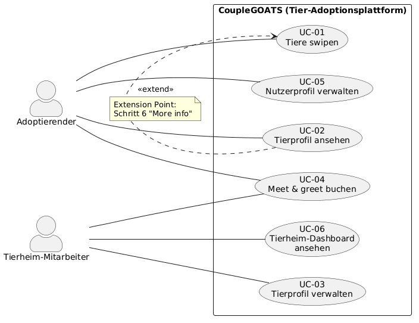

# [Project Name] — Software Requirements Specification

<!--
HOW TO USE THIS TEMPLATE
- Copy the whole docs/ folder into your repository.
- Replace every [placeholder] in square brackets. Comments like this one are guidance: they
  are invisible on GitHub, and you may delete them once a section is done.
- Keep every heading and its number. If a section does not apply, write
  "Not applicable" and one sentence why.
- Every section you write names its author: in the "Author" line below its heading, or in
  the Author column of a table. Prefilled sections need no author.
- Structure after the RUP template "Software Requirements Specification":
  https://cin.ufpe.br/~if682/RUP/webtmpl/templates/req/rup_srs.htm
-->

| Team | Version | Last change |
| ---- | ------- | ----------- |
| CoupleGOATS | 0.3 | 16.10.2026 |

The Git history of this file is the revision history.

## Table of contents

1. [Introduction](#1-introduction)
2. [Overall description](#2-overall-description)
3. [Specific requirements](#3-specific-requirements)
4. [Supporting information](#4-supporting-information)

## 1 Introduction

### 1.1 Purpose

*Author: [first name]*

<!-- One paragraph: what this document describes and who reads it
     (your team, the lecturer as investor, the developer who takes over). -->

This document specifies the requirements of [project name]. […]

### 1.2 Scope

*Author: [first name]*

<!-- What the software does and for whom, in two or three sentences.
     Then split explicitly into in scope and out of scope, each with a reason.
     Out of scope = your MoSCoW "won't have this time". Document later changes here. -->

[Two or three sentences.]

| In scope | Reason |
| -------- | ------ |
| [feature] | [why] |

| Out of scope | Reason |
| ------------ | ------ |
| [feature] | [why not, or not now] |

### 1.3 Definitions, acronyms and abbreviations

*Author: Constantin*

| Term | Meaning |
| ---- | ------- |
| SRS | Software Requirements Specification |
| UC | Use case |
| NFR | Non-functional requirement (quality requirement or constraint) |
| DC | Design Constraint, feste technische Vorgabe (siehe 3.6) |
| Adoptierender | Registrierter Nutzer, der ein Tier sucht und Tierprofile swipt |
| Tierheim | Registriertes Konto eines Tierheims, das Tierprofile pflegt und Meet-&-greet-Anfragen beantwortet |
| Tierprofil | Eintrag eines Tieres mit Stammdaten, Beschreibung, Tags und Fotos |
| Tag | Schlagwort an einem Tierprofil, z. B. „verträglich mit Katzen“ |
| Discovery-Page | Seite, auf der Adoptierende Tierkarten nacheinander angezeigt bekommen und swipen |
| Swipe | Bewertung einer Tierkarte als Like oder Dislike |
| Match | Tier, das ein Adoptierender geliked hat; erscheint auf der Matches-Seite |
| Meet & greet | Besuchstermin im Tierheim, um ein Tier vor der Adoption kennenzulernen |
| Appointments-Seite | Übersicht über offene, bestätigte und vergangene Meet-&-greet-Termine |
| API | Application Programming Interface, hier die REST-Schnittstelle des Backends |
| REST | Representational State Transfer, Architekturstil für HTTP-Schnittstellen |
| ORM | Object-Relational Mapping, hier Drizzle |
| DSGVO | Datenschutz-Grundverordnung (EU) 2016/679 |
| MoSCoW | Priorisierung nach Must, Should, Could und Won't have |

### 1.4 References

*Author: Constantin*

| Title | Link |
| ----- | ---- |
| Blog | [GitHub Discussions](https://github.com/ImConsti/CoupleGOATS/discussions) |
| Board | [CoupleGoats Board](https://github.com/users/ImConsti/projects/1) |
| Repository | [ImConsti/CoupleGOATS](https://github.com/ImConsti/CoupleGOATS) |
| Laufende Anwendung | [couplegoats.85.215.100.89.nip.io](https://couplegoats.85.215.100.89.nip.io/) |
| API-Endpunkte | [api-endpoints.md](api-endpoints.md) |
| OpenAPI-Spezifikation | [openapi.yaml](../apps/backend/openapi.yaml) |
| RUP-Vorlage SRS | [rup_srs.htm](https://cin.ufpe.br/~if682/RUP/webtmpl/templates/req/rup_srs.htm) |
| RUP-Vorlage Use Case | [rup_ucspec.htm](https://cin.ufpe.br/~if682/RUP/webtmpl/templates/req/rup_ucspec.htm) |

### 1.5 Overview

Section 2 describes the product as a whole: vision and use case diagram. Section 3 lists the
specific requirements: the use cases (3.1) and the quality requirements and constraints
(3.2 to 3.12).

## 2 Overall description

### 2.1 Vision

*Author: [first name]*

<!-- Your vision from Task 1, updated: the problem, the target group and the stakeholders,
     the value, and how you differ from alternatives. The investor should get it in two minutes. -->

[…]

### 2.2 Use case diagram

*Author: [first name]*

<!-- One UML use case diagram for the whole application, at least five high-level use cases;
     login and registration do not count. Commit the source file next to the image. -->

### 2.3 Assumptions and dependencies

*Author: [first name]*

<!-- Optional: what you assume (e.g., users have a DHBW account) and what you depend on
     (e.g., an external API). Delete the comment and write "None" if there are none. -->

[…]

## 3 Specific requirements

### 3.1 Functionality

<!-- One subsection per use case. The specification lives in its own file in use_cases/,
     created from UC-00_template.md. Here: name, author, one sentence, link.
     Task 3: at least one specified use case per team member (four entries with a link below).
     List every use case of your diagram; mark the ones not specified yet as "planned". -->

#### 3.1.1 UC-01 Tiere swipen

*Author: Mika* · Adoptierende können Tierprofile ansehen, Tiere mit Like oder Dislike bewerten und anhand von Filtern sowie einem Auswahlalgorithmus weitere passende Tiere entdecken. · [Specification](use_cases/UC-01_swipe.md)

#### 3.1.2 UC-02 Tierprofil ansehen

*Author: brdly06* · Adoptierende können über die Discovery-Page das Detailprofil eines Tieres aufrufen, um dessen Informationen, Bilder sowie das zuständige Tierheim anzusehen. · [Specification](use_cases/UC-02_animal_detail.md)

#### 3.1.3 UC-03 Tierprofil verwalten

*Author: brdly06* · Tierheim-Mitarbeiter können Tierprofile für ihr Tierheim erstellen, bearbeiten, löschen sowie Fotos verwalten und über Vollständigkeitskriterien die Veröffentlichung steuern. · [Specification](use_cases/UC-03_manage_animal.md)

#### 3.1.4 UC-04 Meet & greet buchen

*Author: Constantin* · Adoptierende fragen für ein geliktes Tier einen Besuchstermin beim Tierheim an, das Tierheim bestätigt, lehnt ab oder schlägt einen anderen Termin vor. · [Specification](use_cases/UC-04_meet_and_greet.md)

#### 3.1.5 UC-05 Nutzerprofil verwalten

*Author: Constantin* · Adoptierende bearbeiten ihre Profilangaben und ihr Profilbild oder löschen ihr Konto. · [Specification](use_cases/UC-05_manage_profile.md)

<!-- QUALITY REQUIREMENTS (3.2 to 3.5)
     At least one per section. Each one: an ID, one sentence with "shall", a number you can
     test, and if possible stimulus, response and measure. IDs are unique in the whole SRS,
     including the special requirements of your use cases.
     Example: NFR-P-01 — When 50 users search at the same time, the app lists free slots
     within 1 s for 95 % of the requests. -->

### 3.2 Usability

| ID | Requirement | Author |
| -- | ----------- | ------ |
| NFR-U-01 | Ein neuer Benutzer ohne Vorerfahrung mit der Anwendung muss in der Lage sein, die Hauptaufgabe (ausgenommen Registrierung und / oder Login) nach einer kurzen App-Definition in mindestens 9 von 10 Versuchen innerhalb von 60 Sekunden erfolgreich abzuschließen. | brdly06 |

### 3.3 Reliability

| ID | Requirement | Author |
| -- | ----------- | ------ |
| NFR-R-01 | [measurable requirement] | [first name] |

### 3.4 Performance

| ID | Requirement | Author |
| -- | ----------- | ------ |
| NFR-P-01 | Bei einer Suchanfrage mit bis zu 1.000 gespeicherten Datensätzen muss die Anwendung die Suchergebnisse in mindestens 95 % der Fälle innerhalb von 10 Sekunden anzeigen. | brdly06 |

### 3.5 Supportability

| ID | Requirement | Author |
| -- | ----------- | ------ |
| NFR-S-01 | Jeder REST-Endpunkt des Backends muss in `openapi.yaml` dokumentiert sein; ein Abgleich der implementierten Routen mit der Spezifikation muss 100 % Abdeckung ergeben. | Constantin |
| NFR-S-02 | Ein neues Teammitglied muss das Projekt anhand der README in höchstens 15 Minuten lokal starten können (Frontend und Backend laufen, Datenbank ist migriert). | Constantin |
| NFR-S-03 | Der Code auf `main` muss `npm run lint` in Frontend und Backend mit 0 Fehlern bestehen. | Constantin |

### 3.6 Design constraints

*Author: Constantin*

| ID | Constraint |
| -- | ---------- |
| DC-01 | Frontend: TypeScript, Next.js 16 (App Router) mit React 19 und Tailwind CSS 4 |
| DC-02 | Backend: TypeScript auf Node.js 22, Express 5, Validierung mit Zod |
| DC-03 | Database: SQLite über den libSQL-Client, Schema und Migrationen mit Drizzle ORM |
| DC-04 | Schnittstelle zwischen Frontend und Backend: REST mit JSON, beschrieben in OpenAPI 3 |
| DC-05 | Auslieferung: Frontend und Backend als Docker-Images, gebaut per GitHub Actions bei jedem Push auf `main` |
| DC-06 | Repository: Monorepo mit `apps/frontend` und `apps/backend` |

### 3.7 Online user documentation and help system requirements

*Author: Constantin*

Not applicable. Die Anwendung soll ohne Handbuch bedienbar sein (siehe NFR-U-01); nötige Hinweise stehen direkt in der Oberfläche, z. B. bei Fehlermeldungen in Formularen.

### 3.8 Purchased components

*Author: Constantin*

Not applicable. Das Projekt hat kein Budget und verwendet ausschließlich freie Open-Source-Bibliotheken (siehe 3.10).

### 3.9 Interfaces

#### 3.9.1 User interfaces

*Author: [first name]*

<!-- Link the mockups of your use cases, or describe the main screens in one line each. -->

[…]

#### 3.9.2 Hardware interfaces

*Author: Constantin*

Not applicable. CoupleGOATS ist eine reine Webanwendung und steuert keine Hardware direkt an; Fotos werden über den normalen Datei-Upload des Browsers ausgewählt.

#### 3.9.3 Software interfaces

*Author: Constantin*

| Schnittstelle | Beschreibung |
| ------------- | ------------ |
| Webbrowser | Das Frontend läuft in den jeweils aktuellen Versionen von Chrome, Firefox, Safari und Edge, auf Desktop und Smartphone. |
| REST-API des Backends | Das Frontend greift ausschließlich über die REST-API unter `/api` auf Daten zu. Die Endpunkte sind in [api-endpoints.md](api-endpoints.md) und [openapi.yaml](../apps/backend/openapi.yaml) beschrieben und als Swagger UI unter `/api/docs` abrufbar. |
| Datenbank | Das Backend speichert alle Daten einschließlich der Bilder in einer SQLite-Datei und greift über Drizzle ORM darauf zu. Nur das Backend hat Zugriff auf die Datenbank. |
| Externe Dienste | Derzeit keine. Ein E-Mail-Dienst für Benachrichtigungen zu Meet-&-greet-Anfragen ist eine mögliche Erweiterung. |

#### 3.9.4 Communications interfaces

*Author: Constantin*

- Browser und Server kommunizieren ausschließlich über HTTPS (TLS); unverschlüsselte HTTP-Aufrufe werden auf HTTPS umgeleitet.
- Frontend und Backend tauschen JSON über HTTP aus; Bild-Uploads nutzen `multipart/form-data`, Bild-Downloads `image/*`.
- Geschützte Endpunkte erwarten das Token des angemeldeten Kontos im `Authorization`-Header; Fehler werden mit den HTTP-Statuscodes `400`, `401`, `403` und `404` gemeldet.

### 3.10 Licensing requirements

*Author: Constantin*

Für das Projekt selbst ist noch keine Lizenz festgelegt; bis dahin liegen alle Rechte beim Team. Alle eingesetzten Bibliotheken stehen unter freizügigen Open-Source-Lizenzen, die eine kostenlose Nutzung erlauben und nur verlangen, dass der Lizenz- und Copyright-Hinweis bei einer Weitergabe erhalten bleibt:

| Bibliothek | Lizenz |
| ---------- | ------ |
| Next.js, React, Tailwind CSS | MIT |
| Express, cors, Zod, @libsql/client, swagger-ui-express | MIT |
| Drizzle ORM | Apache-2.0 |
| yaml | ISC |
| dotenv | BSD-2-Clause |

Neue Abhängigkeiten mit Copyleft-Lizenzen (z. B. GPL) dürfen nur nach Absprache im Team aufgenommen werden.

### 3.11 Legal, copyright and other notices

*Author: [first name]*

<!-- E.g., data protection (GDPR) if you store personal data. -->

[…]

### 3.12 Applicable standards

*Author: brdly06*

| Standard | Requirement |
| ----- | ----- |
| WCAG 2.2 Level AA | Die Benutzeroberfläche muss die geltenden Barrierefreiheitsanforderungen gemäß WCAG 2.2 Level AA erfüllen. Die Barrierefreiheit wird durch automatisierte Barrierefreiheitstests und manuelle Tastaturnavigationstests überprüft. |
| Konsistentes Design | Die Anwendung muss über alle Seiten hinweg ein konsistentes Design verwenden, einschließlich einheitlicher Farben, Typografie, Schaltflächen, Formularelemente, Navigation und Fehlermeldungen. |
| Coding-Standard | Das Projekt muss TypeScript für den Frontend- und Backend-Code verwenden und konsistente Programmierkonventionen einhalten. Code-Formatierung und Linting werden automatisch mithilfe konfigurierter Tools überprüft. |
| Git- und GitHub-Versionskontrolle | Der gesamte Quellcode des Projekts muss mit Git verwaltet und im GitHub-Repository des Teams gehostet werden. Änderungen müssen mit aussagekräftigen Nachrichten committet und Beiträge über Pull Requests integriert werden. |
| Web Application Security (OWASP) | Die Anwendung muss die geltenden OWASP-Sicherheitsempfehlungen befolgen, insbesondere in Bezug auf Authentifizierung, Autorisierung, Eingabevalidierung sowie den Schutz von Benutzer- und Tierheimsdaten. |

## 4 Supporting information

<!-- Optional: appendices, glossary extensions, interview notes. -->

None.
