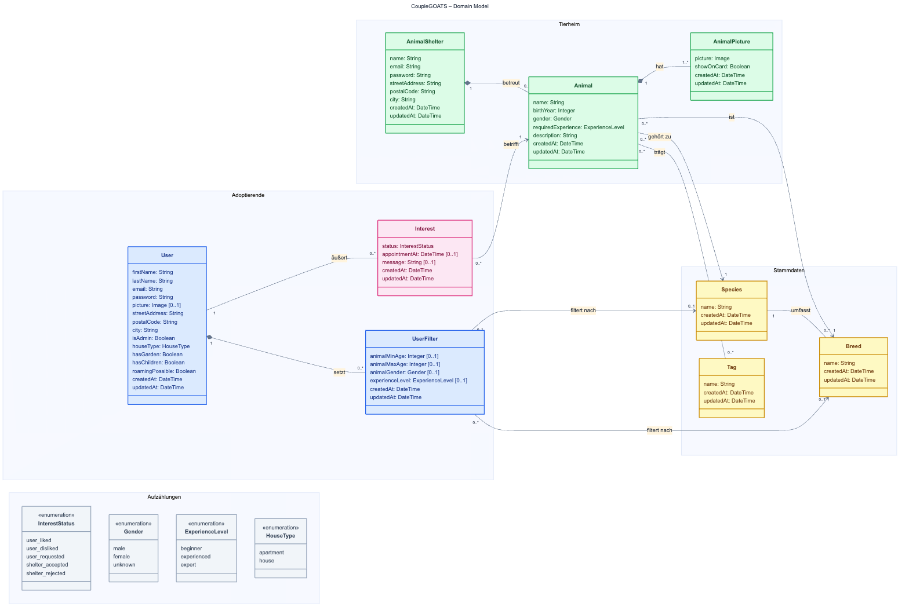

# Domain model

| Authors | Carolin, Mika, Aaron, Constantin |
| ------- | -------------------------------- |

Quelle: [domain_model.mmd](diagrams/domain_model.mmd) (Mermaid). Farben: grün = Tierheim, blau = Adoptierende, rosa = `Interest` als Verbindung zwischen beiden, gelb = Stammdaten, grau = Aufzählungen.

## Classes

| Class | Meaning |
| ----- | ------- |
| `AnimalShelter` | Ein Tierheim mit Account, das Tierprofile anlegt und Meet-&-greet-Anfragen beantwortet. |
| `Animal` | Das Tierprofil eines Tieres, das ein Tierheim zur Adoption anbietet. Adoptierende bekommen das Tierprofil auf der Discovery-Page angezeigt. |
| `AnimalPicture` | Ein Foto eines Tieres. Genau ein Foto pro Tier wird als Kartenbild (`showOnCard`) auf der Discovery-Page und im Dashboard gezeigt. |
| `Species` | Eine Tierart, z. B. Hund oder Katze. |
| `Breed` | Eine Rasse innerhalb einer Tierart. |
| `Tag` | Ein Schlagwort, das ein Tier beschreibt, z. B. „verspielt“ oder „katzenverträglich“. |
| `User` | Ein Adoptierender mit Profil, Adresse und Wohnsituation; Grundlage für passende Tiervorschläge. |
| `UserFilter` | Die Suchfilter eines Adoptierenden (Art, Rasse, Alter, Geschlecht, Erfahrung) für die Discovery-Page. |
| `Interest` | Die Beziehung eines Adoptierenden zu einem Tier: Like/Dislike beim Swipen und daraus die Meet-&-greet-Anfrage mit Termin. Höchstens ein `Interest` pro Adoptierendem und Tier. |
| `InterestStatus` | Der Stand eines `Interest`, siehe Zustandsautomat in [UCR-04](use_case_realizations/UCR-04_meet_and_greet.md#24-zustandsautomat). |
| `Gender` | Geschlecht eines Tieres. |
| `ExperienceLevel` | Erfahrung, die ein Tier vom Adoptierenden verlangt bzw. die ein Adoptierender im Filter angibt. |
| `HouseType` | Wohnform des Adoptierenden. |
