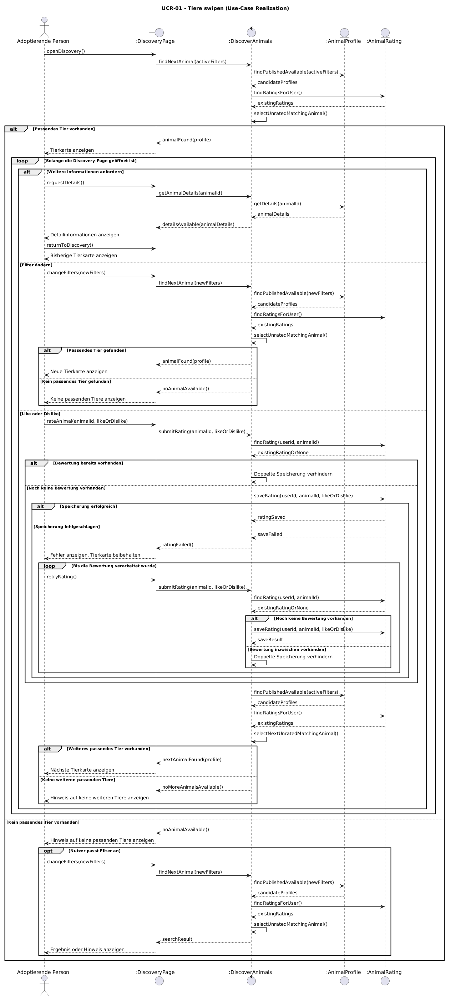

# UCR-01 swipe — Use-Case Realization

<!--
HOW TO USE THIS TEMPLATE
- Copy this file per realization and name it UCR-[NN]_[name].md, with the number of its
  use case: UCR-02_book_a_room.md realizes UC-02.
- Replace every [placeholder] in square brackets.
- Stay at the analysis level from Lecture 4: boundary, control, and entity objects, no
  framework classes yet. Task 5 replaces them with your design classes.
- Delete these comments once the realization is done.
- Structure after the RUP template "Use-Case Realization Specification":
  https://cin.ufpe.br/~if682/RUP/webtmpl/templates/a_and_d/rup_ucrs.htm
  Section 2 is RUP's "Flow of Events — Design".
-->

| Author | Realizes |
| ------ | -------- |
| Mika | [UC-01 Tiere swipen](../use_cases/UC-01_swipe.md) |

## 1 Introduction

<!-- Two or three sentences: which use case this realizes, which of its flows it covers, and
     what is left out. Terms belong in the SRS, not here. -->

Diese Use-Case-Realization konkretisiert UC-01 „Tiere swipen“ für das Entdecken, Anzeigen und Bewerten von Tierprofilen auf der Discovery-Page von CoupleGOATS. Sie beschreibt den Basic Flow sowie die Alternativen für fehlende passende Tiere, Detailinformationen, Filteränderungen, fehlgeschlagene Bewertungsübermittlung und bereits vorhandene Bewertungen. Die Erstellung und Verwaltung von Tierprofilen durch Tierheime ist nicht Bestandteil dieser Realization, da sie in UC-03 behandelt wird.

## 2 Flow of events — design

### 2.1 Participating objects

<!-- Every object in your sequence diagrams, with one responsibility each.
     Boundary: between an actor and the system — one per actor and use case;
               an external system is reached through a boundary too.
     Control:  coordinates this use case — usually one.
     Entity:   information that must be stored. -->

| Object | Stereotype | Responsibility |
|---|---|---|
| :DiscoveryPage | <<boundary>> | Vermittelt zwischen Adoptierendem und Anwendung: übermittelt Such- und Bewertungsaktionen und zeigt Tierkarten (Bild mit `show_on_card`), Detailansichten sowie Status- und Fehlermeldungen an. |
| :DiscoverAnimals | <<control>> | Koordiniert die Tierermittlung, lädt die Filter des Nutzers (`user_filters`), schließt Tiere aus, für die bereits ein `interests`-Eintrag existiert, steuert die Verarbeitung einer Bewertung und die Suche nach dem nächsten Tier. |
| :Animal | <<entity>> | Stellt gespeicherte Tierdaten aus `animals` bereit (inkl. `animal_pictures`, `animals_tags`/`tags`, `species`, `breeds` und Tierheim aus `animal_shelters`) und liefert passende Tierprofile für die Suche, gefiltert nach Art, Rasse, Alter (aus `birth_year`), Geschlecht und `required_experience`. |
| :Interest | <<entity>> | Stellt gespeicherte Bewertungen aus `interests` bereit (Schlüssel: `user_id` + `animal_id`, Feld `status`) und ermöglicht die Prüfung sowie Speicherung einer Bewertung pro Nutzer und Tier. |
| :UserFilter | <<entity>> | Stellt die gespeicherten Suchfilter des Nutzers aus `user_filters` bereit (`animal_species`, `animal_breed`, `animal_min_age`, `animal_max_age`, `animal_gender`, `experience_level`). |

### 2.2 Sequence diagrams

<!-- The basic flow and the alternative flows: alt if a flow rejoins, break if it ends the use
     case, opt for an optional step, loop for a repeated one, ref for an included use case.
     One diagram is enough while it stays readable; otherwise one per flow.
     Commit the source file next to the image. -->

### 2.3 Walkthrough

<!-- Walk through the diagrams in a few sentences: which object does what, in which order,
     and how the diagrams fit together. Refer to the steps of the use case (1, 2, 4a …). -->

Beim Öffnen der Discovery-Page übergibt der Nutzer die Anfrage an `:DiscoveryPage`. Die Boundary leitet die Anfrage mit der Nutzerkennung an `:DiscoverAnimals` weiter. Das Control-Objekt lädt zunächst die gespeicherten Filter des Nutzers über `:UserFilter` und ermittelt anschließend über `:Animal` die passenden Tiere. Über `:Interest` werden die bisherigen Bewertungen des Nutzers abgerufen, sodass nur Tiere ausgewählt werden, für die noch kein Eintrag existiert. Das gefundene Tier wird durch die Boundary als Tierkarte angezeigt. Ist kein passendes Tier verfügbar, zeigt die Boundary einen entsprechenden Hinweis; der Nutzer kann die Filter anpassen oder den Use Case beenden.

Während eine Tierkarte angezeigt wird, kann der Nutzer weitere Informationen anfordern. Die Boundary lässt die Detailinformationen durch das Control-Objekt über `:Animal` ermitteln und zeigt sie an; nach der Rückkehr wird die bisherige Tierkarte erneut dargestellt. Bei einer Filteränderung übermittelt die Boundary die neuen Filter an das Control-Objekt, das sie über `:UserFilter` speichert und anschließend eine neue Suche ausführt.

Wählt der Nutzer Like oder Dislike, übergibt die Boundary die Tierkennung und den Status an `:DiscoverAnimals`. Das Control-Objekt prüft über `:Interest`, ob bereits ein Eintrag für diesen Nutzer und dieses Tier existiert. Ein vorhandener Eintrag wird nicht doppelt gespeichert; andernfalls wird das neue Interest gespeichert. Bei einem Übermittlungs- oder Verarbeitungsfehler zeigt die Boundary eine Fehlermeldung und ermöglicht einen erneuten Versuch, während die aktuelle Tierkarte erhalten bleibt. Nach erfolgreicher Verarbeitung wird das nächste passende Tier gesucht und angezeigt. Sind keine weiteren passenden Tiere verfügbar, informiert die Boundary den Nutzer; dieser kann die Filter ändern oder die Discovery-Page verlassen.

### 2.4 State machine

<!-- Optional. Only if an entity in this realization has a status with rules, e.g., a booking
     that is confirmed, canceled, or expired. Otherwise write "Not applicable". -->

Not applicable

## 3 Derived requirements

<!-- Requirements the design adds and the implementation must handle, each with an ID that is
     unique in the whole SRS, e.g.,
     DR-02-01 — The slot check and the insert of the booking run in one transaction.
     DR-02-02 — The e-mails are sent asynchronously; a failed send is retried three times.
     Write "None" if there are none. -->

- **DR-01-01** — Eine Bewertung darf nicht doppelt für denselben Nutzer und dasselbe Tier gespeichert werden.
- **DR-01-02** — Bei einer fehlgeschlagenen Bewertungsübermittlung muss die aktuelle Tierkarte erhalten bleiben und ein erneuter Versuch möglich sein.
- **DR-01-03** — Die Ermittlung eines passenden Tieres muss aktive Filter, die Verfügbarkeit und den Veröffentlichungsstatus des Tierprofils sowie bereits gespeicherte Bewertungen berücksichtigen.
- **DR-01-04** — Nach erfolgreicher Verarbeitung einer Bewertung muss das System das nächste passende, noch nicht bewertete Tier ermitteln, sofern eines verfügbar ist.
