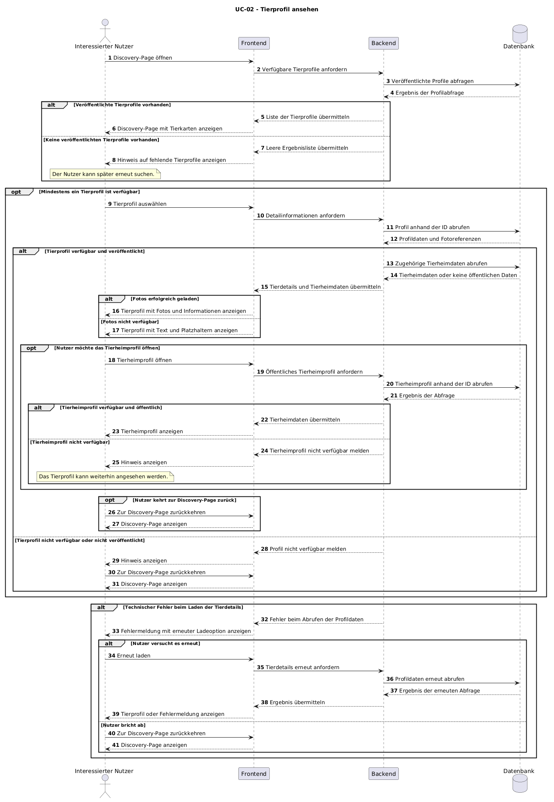
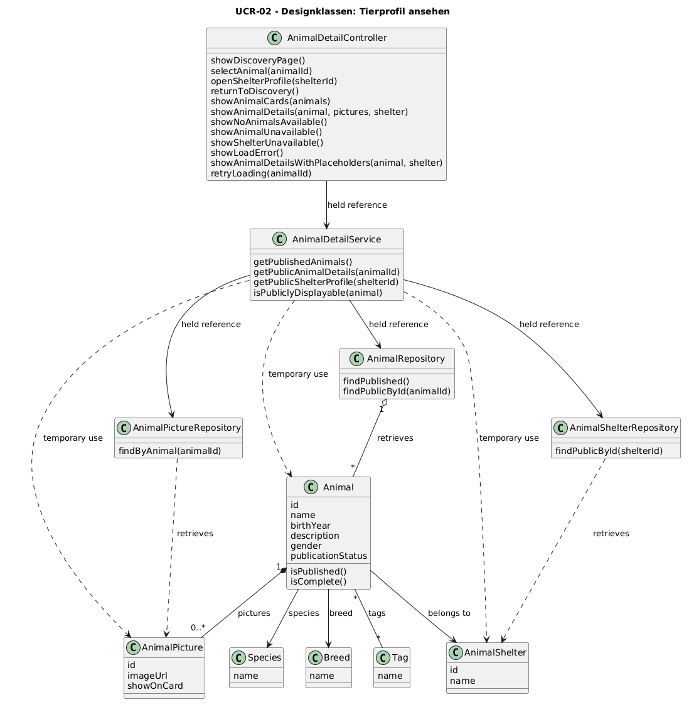

# UCR-02 Tierprofil ansehen — Use-Case-Realization

| Autor | Realisiert |
|---|---|
| brdly06 | [UC-02 Tierprofil ansehen](../use_cases/UC-02_animal_detail.md) |

## 1 Einleitung

Diese Use-Case-Realization beschreibt die technische Umsetzung des Use Cases UC-02 „Tierprofil ansehen“. Sie konkretisiert den Hauptablauf vom Öffnen der Discovery-Page über die Auswahl eines Tierprofils bis zur Anzeige der zugehörigen Informationen sowie die relevanten Alternativabläufe bei nicht verfügbaren Tierprofilen, fehlenden Fotos, technischen Fehlern und nicht verfügbaren Tierheimprofilen. Die konkrete Implementierung mit bestimmten Frameworks, Programmiersprachen und technischen Klassen ist nicht Bestandteil dieser Realization.

## 2 Ablauf der Ereignisse – Entwurf

### 2.1 Beteiligte Objekte

| Objekt | Stereotyp | Verantwortung |
|---|---|---|
| `Interessierter Nutzer` | `actor` | Öffnet die Discovery-Page, wählt ein Tierprofil aus, betrachtet die Tierdetails und kann zur Discovery-Page zurückkehren oder das Tierheimprofil öffnen. |
| `Frontend` | `boundary` | Stellt die Discovery-Page und die Tierprofilansicht dar, nimmt Nutzereingaben entgegen und zeigt Ergebnisse sowie Fehlermeldungen an. |
| `Backend` | `control` | Verarbeitet die Anfragen des Frontends, prüft die öffentliche Verfügbarkeit der Tierprofile, ruft benötigte Daten ab und übermittelt die Ergebnisse an das Frontend. |
| `Datenbank` | `entity` | Speichert die Tierprofile, deren Veröffentlichungsstatus, die zugehörigen Fotoreferenzen sowie die relevanten Tierheimdaten. |

### 2.2 Sequenzdiagramme

Das Sequenzdiagramm stellt die Kommunikation zwischen dem interessierten Nutzer, dem Frontend, dem Backend und der Datenbank dar. Es beschreibt den Hauptablauf sowie Alternativen bei fehlenden veröffentlichten Tierprofilen und nicht verfügbaren Tierprofilen. Ergänzende Fehler- und Sonderfälle werden in der Ablaufbeschreibung erläutert.

Das Diagramm wird aus der vorhandenen PlantUML-Datei `UCR-02_sequence.puml` erzeugt und als PNG-Datei im Verzeichnis `diagrams` abgelegt.

Die zugehörige PlantUML-Quelldatei befindet sich unter `../diagrams/UCR-02_sequence.puml`.

### 2.3 Ablaufbeschreibung

#### Hauptablauf

1. Der interessierte Nutzer öffnet die Discovery-Page im Frontend.
2. Das Frontend fordert beim Backend die verfügbaren Tierprofile an.
3. Das Backend fragt die Datenbank nach veröffentlichten und öffentlich sichtbaren Tierprofilen ab.
4. Die Datenbank liefert die gefundenen Tierprofile zurück.
5. Das Backend übermittelt die Ergebnisliste an das Frontend.
6. Das Frontend zeigt die verfügbaren Tierprofile als Tierkarten auf der Discovery-Page an.
7. Der interessierte Nutzer wählt ein Tierprofil aus.
8. Das Frontend fordert die Detailinformationen zum ausgewählten Tierprofil beim Backend an.
9. Das Backend ruft das Tierprofil anhand seiner ID aus der Datenbank ab und prüft, ob es weiterhin veröffentlicht und öffentlich verfügbar ist.
10. Das Backend lädt beziehungsweise ermittelt die zugehörigen Fotoreferenzen und die relevanten Tierheimdaten.
11. Das Backend übermittelt die verfügbaren Informationen an das Frontend.
12. Das Frontend zeigt das Tierprofil mit den verfügbaren Fotos und Informationen an. Dazu gehören insbesondere Name, Tierart, Rasse, Alter, Geschlecht, Tags, Beschreibung und Tierheimname.
13. Der interessierte Nutzer kann das Tierprofil ansehen, zur Discovery-Page zurückkehren oder – sofern verfügbar – das zugehörige Tierheimprofil öffnen.

#### Alternativabläufe

**A1 – Keine veröffentlichten Tierprofile vorhanden**

Wenn die Datenbank keine veröffentlichten Tierprofile zurückliefert, übermittelt das Backend eine leere Ergebnisliste an das Frontend. Das Frontend zeigt einen verständlichen Hinweis an, dass aktuell keine Tierprofile verfügbar sind. Der Nutzer kann die Suche zu einem späteren Zeitpunkt erneut durchführen. Der Use Case wird beendet.

**A2 – Tierprofil ist nicht mehr verfügbar**

Wenn ein ausgewähltes Tierprofil inzwischen gelöscht, zurückgezogen oder nicht mehr veröffentlicht wurde, liefert die Datenbank kein öffentlich verfügbares Profil zurück. Das Backend meldet dem Frontend, dass das Tierprofil nicht verfügbar ist. Das Frontend zeigt einen entsprechenden Hinweis an und ermöglicht dem Nutzer die Rückkehr zur Discovery-Page. Es werden keine nicht öffentlichen Tierdaten angezeigt. Der Use Case wird beendet.

**A3 – Tierprofil erfüllt die Anforderungen an die öffentliche Anzeige nicht**

Wenn das abgerufene Tierprofil unvollständig ist oder die Anforderungen an die öffentliche Anzeige nicht erfüllt, darf das Backend die betreffenden Daten nicht als öffentlich verfügbares Tierprofil ausgeben. Das Backend übermittelt eine entsprechende Rückmeldung an das Frontend. Das Frontend informiert den Nutzer über die Nichtverfügbarkeit und ermöglicht die Rückkehr zur Discovery-Page. Der Use Case wird beendet.

**A4 – Technischer Fehler beim Laden der Tierdetails**

Wenn beim Abrufen oder Übermitteln der Tierdetails ein technischer Fehler auftritt, informiert das Backend das Frontend über den Fehler. Das Frontend zeigt eine verständliche Fehlermeldung an und bietet dem Nutzer an, den Ladevorgang erneut auszuführen. Bei einem erneuten Versuch fordert das Frontend die Tierdetails erneut beim Backend an. Wenn der Nutzer den Vorgang abbricht, kann er zur Discovery-Page zurückkehren. Ein fehlgeschlagener Abruf darf nicht als erfolgreich geladenes Tierprofil dargestellt werden.

**A5 – Fotos können nicht geladen werden**

Wenn einzelne oder alle Fotos nicht geladen werden können, zeigt das Frontend die weiterhin verfügbaren Textinformationen des Tierprofils an. Für nicht verfügbare Fotos können Platzhalter angezeigt werden. Der Fehler beim Laden der Fotos verhindert nicht die Anzeige der übrigen verfügbaren Tierinformationen.

**A6 – Tierheimprofil ist nicht verfügbar oder nicht öffentlich**

Wenn der Nutzer das zugehörige Tierheimprofil öffnen möchte, fordert das Frontend die entsprechenden Daten beim Backend an. Ist das Tierheimprofil nicht vorhanden oder nicht öffentlich zugänglich, zeigt das Frontend einen Hinweis an. Das Tierprofil bleibt weiterhin verfügbar, sofern es selbst noch veröffentlicht und öffentlich sichtbar ist. Der Nutzer kann das Tierprofil weiter ansehen oder zur Discovery-Page zurückkehren.

**A7 – Nutzer kehrt zur Discovery-Page zurück**

Wenn der Nutzer das Tierprofil nicht weiter ansehen möchte oder das Tierheimprofil nicht öffnen will, kann er zur Discovery-Page zurückkehren. Das Frontend zeigt die Discovery-Page erneut an. Der Use Case wird beendet.

### 2.4 Zustandsautomat

Nicht anwendbar. Für diese Use-Case-Realization wird kein eigener Zustandsautomat definiert, da der Ablauf hauptsächlich durch die Interaktion zwischen Nutzer, Frontend, Backend und Datenbank bestimmt wird. Der Veröffentlichungsstatus eines Tierprofils wird bei der Datenabfrage geprüft, begründet in dieser Realization jedoch keinen eigenständigen Zustandsautomaten.

### 2.5 Design classes

Die Analyseobjekte aus Abschnitt 2.1 werden den folgenden Designklassen zugeordnet. Der Controller bildet die Schnittstelle zwischen Frontend und Anwendungslogik. Der Service koordiniert die Abfragen und prüft, ob Tierprofile und Tierheimdaten öffentlich angezeigt werden dürfen. Die Repositories greifen auf die gespeicherten Domain-Objekte zu.

#### Mapping der Analyseobjekte

| Analyseobjekt aus 2.1 | Designklasse(n) | Begründung |
|---|---|---|
| `Interessierter Nutzer` | Actor, keine Designklasse | Der Nutzer löst die Aktionen aus und interagiert mit dem Frontend. |
| `Frontend` | `AnimalDetailController` | Nimmt Anfragen zur Discovery-Page und zu Tierdetails entgegen und stellt Ergebnisse, Statusmeldungen und Fehler dar. |
| `Backend` | `AnimalDetailService` | Koordiniert das Laden der Tierprofile, prüft die öffentliche Verfügbarkeit und ruft Fotos sowie Tierheimdaten ab. |
| `Datenbank` | `AnimalRepository`, `AnimalPictureRepository`, `AnimalShelterRepository` sowie `Animal`, `AnimalPicture` und `AnimalShelter` | Die Repositories laden die benötigten Daten. Die Domain-Klassen repräsentieren Tierprofile, Fotos und Tierheime. |

#### Klassendiagramm

Das Klassendiagramm zeigt die am Use Case beteiligten Designklassen und die für das Sequenzdiagramm benötigten Operationen. Durchgezogene gerichtete Linien kennzeichnen gehaltene Referenzen. Gestrichelte Pfeile kennzeichnen die kurzzeitige Verwendung von Domain-Objekten.

Die PlantUML-Quelldatei liegt unter `../diagrams/UCR-02_classes.puml`. Das gerenderte Diagramm wird unter `../diagrams/UCR-02_classes.png` abgelegt.

#### Sequenzdiagramm mit Designklassen

Das Design-Sequenzdiagramm konkretisiert das ursprüngliche Analyse-Sequenzdiagramm mit einem Controller, einem Service und den benötigten Repositories. Es bildet das Laden der Discovery-Page, die Anzeige eines ausgewählten Tierprofils sowie die relevanten Alternativabläufe ab. Das ursprüngliche Diagramm `UCR-02_sequence.puml` bleibt unverändert erhalten.

Die Quelldatei der Designversion liegt unter `../diagrams/UCR-02_sequence_design.puml`. Das gerenderte Diagramm wird unter `../diagrams/UCR-02_sequence_design.png` abgelegt.

## 3 Abgeleitete Anforderungen

Keine. Die Use-Case-Realization konkretisiert den bestehenden Use Case UC-02 und beschreibt die Zusammenarbeit der beteiligten Objekte sowie die vorgesehenen Alternativabläufe. Es werden keine zusätzlichen fachlichen Anforderungen eingeführt.
