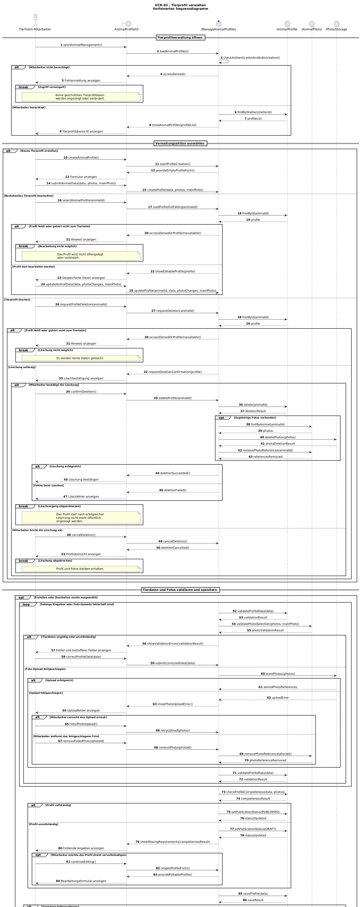
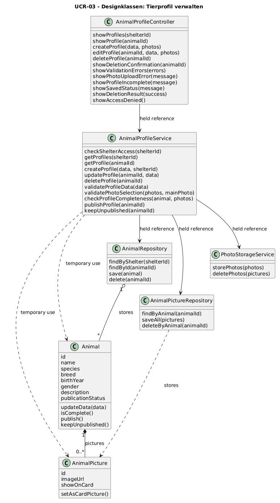

# UCR-03 Tierprofil verwalten — Use-Case-Realization

| Autor | Realisiert |
|---|---|
| brdly06 | [UC-03 Tierprofil verwalten](../use_cases/UC-03_manage_animal.md) |

## 1 Introduction

Diese Use-Case-Realization konkretisiert UC-03 „Tierprofil verwalten“ und beschreibt die Zusammenarbeit der beteiligten Objekte beim Erstellen, Bearbeiten und Löschen von Tierprofilen. Sie berücksichtigt den Basisablauf sowie die Alternativabläufe für fehlende Berechtigungen, ungültige Eingaben, fehlerhafte Foto-Uploads, unvollständige Profile, abgebrochene Löschvorgänge und fehlgeschlagene Speichervorgänge. Die Realization dient als Grundlage für die spätere Umsetzung mit konkreten Klassen.

## 2 Flow of events – design

### 2.1 Participating objects

| Objekt | Stereotyp | Verantwortung |
|---|---|---|
| `Tierheim-Mitarbeiter` | `actor` | Startet die Tierprofilverwaltung, wählt eine Verwaltungsaktion aus, gibt Tierdaten ein, verwaltet Fotos, bestätigt Löschvorgänge und korrigiert fehlerhafte Eingaben. |
| `:AnimalProfileUI` | `boundary` | Stellt die Tierprofilübersicht, Formulare und Bestätigungsdialoge bereit. Nimmt Nutzereingaben entgegen und zeigt Tierprofile, Statusinformationen und Fehlermeldungen an. |
| `:ManageAnimalProfiles` | `control` | Steuert den Verwaltungsablauf, prüft Berechtigungen, koordiniert Validierung und Speicherung und entscheidet anhand der Vollständigkeit über die Veröffentlichung eines Tierprofils. |
| `:AnimalProfile` | `entity` | Repräsentiert ein Tierprofil mit Name, Tierart, Rasse, Geburtsjahr, Geschlecht, Beschreibung, Tags und Veröffentlichungsstatus. |
| `:AnimalPhoto` | `entity` | Repräsentiert die einem Tierprofil zugeordneten Fotos und deren Zuordnung, einschließlich der Kennzeichnung eines Hauptbildes. |
| `:PhotoStorage` | `entity` | Repräsentiert optional einen separaten Bildspeicher, der Fotos speichert, abruft und bei Löschvorgängen gemäß den geltenden Regeln entfernt. |

### 2.2 Sequence diagrams

Das Sequenzdiagramm verfeinert den Ablauf aus UC-03 und stellt die Interaktion zwischen dem Tierheim-Mitarbeiter, der Benutzeroberfläche, der Steuerung und den fachlichen Objekten dar. Die drei Verwaltungsaktionen werden als alternative Abläufe modelliert. Weitere `alt`-, `opt`-, `loop`- und `break`-Fragmente verdeutlichen Berechtigungsprüfungen, Validierungsfehler, fehlgeschlagene Foto-Uploads, unvollständige Profile, Speicherfehler und die Bestätigung beziehungsweise den Abbruch einer Löschung.

Die PlantUML-Quelldatei liegt unter `../diagrams/UCR-03_sequence.puml`. Das gerenderte Diagramm wird unter `../diagrams/UCR-03_sequence.png` abgelegt.

### 2.3 Walkthrough

Zu Beginn öffnet der Tierheim-Mitarbeiter die Tierprofilverwaltung. Die Benutzeroberfläche leitet die Anfrage an das Steuerungsobjekt weiter, das die Berechtigung und die Zugehörigkeit zum zuständigen Tierheim prüft. Bei fehlender Berechtigung wird der Zugriff verweigert, ohne geschützte Daten offenzulegen.

Nach erfolgreicher Prüfung werden die vorhandenen Tierprofile angezeigt. Der Mitarbeiter kann ein neues Profil erstellen, ein bestehendes Profil bearbeiten oder ein Profil löschen. Beim Erstellen und Bearbeiten werden die eingegebenen Tierdaten validiert und die Fotos verwaltet. Ungültige Angaben oder fehlgeschlagene Uploads führen zu einer Fehlermeldung und ermöglichen eine Korrektur oder einen erneuten Upload.

Nach erfolgreicher Validierung prüft die Steuerung, ob alle Anforderungen an die Vollständigkeit erfüllt sind. Vollständige Profile können veröffentlicht werden; unvollständige Profile bleiben unveröffentlicht und können als Entwurf gespeichert werden. Bei einem fehlgeschlagenen Speichervorgang wird keine erfolgreiche Speicherung bestätigt und ein erneuter Versuch kann angeboten werden.

Beim Löschen eines Tierprofils wird zunächst eine ausdrückliche Bestätigung angefordert. Nur bei bestätigter Löschung werden das Profil und die zugehörigen Fotos gemäß den geltenden Löschregeln entfernt. Wird die Löschung abgebrochen, bleiben die Daten erhalten. Dadurch werden die fachlichen Regeln für Zugriffskontrolle, Veröffentlichung und Löschung im Ablauf berücksichtigt.

### 2.4 State machine

Ein separater Zustandsautomat ist für diese Realization nicht erforderlich. Der Veröffentlichungsstatus eines Tierprofils wird jedoch durch die Steuerung anhand seiner Vollständigkeit verwaltet. Ein Profil kann unveröffentlicht bleiben, als Entwurf gespeichert oder nach Erfüllung aller Anforderungen veröffentlicht werden. Beim Löschen wird das Profil aus der öffentlichen Discovery-Page entfernt.

### 2.5 Design classes

Die Analyseobjekte aus Abschnitt 2.1 werden den folgenden Designklassen zugeordnet. Die Benutzeroberfläche wird durch einen Controller angebunden, der Service koordiniert den Ablauf und die Repositories übernehmen den Zugriff auf die gespeicherten Daten. Die fachlichen Informationen bleiben in den Domain-Model-Klassen `Animal` und `AnimalPicture`.

#### Mapping der Analyseobjekte

| Analyseobjekt aus 2.1 | Designklasse(n) | Begründung |
|---|---|---|
| `Tierheim-Mitarbeiter` | Actor, keine Designklasse | Der Mitarbeiter löst die Aktionen aus und interagiert mit der Benutzeroberfläche. |
| `:AnimalProfileUI` | `AnimalProfileController` | Nimmt Aktionen entgegen und gibt Ergebnisse, Statusmeldungen und Fehler an die Benutzeroberfläche weiter. |
| `:ManageAnimalProfiles` | `AnimalProfileService` | Koordiniert Berechtigungsprüfung, Validierung, Vollständigkeitsprüfung, Veröffentlichung und Löschung. |
| `:AnimalProfile` | `Animal` und `AnimalRepository` | `Animal` repräsentiert das Tierprofil; das Repository lädt, speichert und löscht es. |
| `:AnimalPhoto` | `AnimalPicture` und `AnimalPictureRepository` | `AnimalPicture` repräsentiert ein Tierfoto; das Repository verwaltet die gespeicherten Zuordnungen. |
| `:PhotoStorage` | `PhotoStorageService` | Speichert Fotos und entfernt sie bei einem entsprechenden Löschvorgang. |

#### Klassendiagramm

Das Klassendiagramm zeigt nur die am Use Case beteiligten Designklassen. Durchgezogene gerichtete Linien kennzeichnen gehaltene Referenzen. Gestrichelte Pfeile kennzeichnen die kurzzeitige Verwendung von Domain-Objekten durch den Service.

Die Klassendiagramm-Quelldatei liegt unter `../diagrams/UCR-03_classes.puml`; die gerenderte Grafik unter `../diagrams/UCR-03_classes.png`.

#### Sequenzdiagramm mit Designklassen

Das Design-Sequenzdiagramm verwendet dieselben Klassennamen und die unten dargestellten Methoden. Es konkretisiert das ursprüngliche Analyse-Sequenzdiagramm für das Anzeigen, Erstellen, Bearbeiten und Löschen von Tierprofilen. Das ursprüngliche Diagramm `UCR-03_sequence.puml` bleibt als Analyseversion erhalten.

Die Quelldatei der Designversion liegt unter `../diagrams/UCR-03_sequence_design.puml`; die gerenderte Grafik unter `../diagrams/UCR-03_sequence_design.png`.

## 3 Derived requirements

Keine. Die Use-Case-Realization konkretisiert die bestehenden Abläufe und fachlichen Regeln aus UC-03. Sie führt keine zusätzlichen fachlichen Anforderungen ein. Technische Einzelheiten wie konkrete Datenbankklassen, Frameworks, Transaktionsmechanismen und die tatsächliche Implementierung des Bildspeichers werden erst im Rahmen der späteren Implementierung festgelegt.
