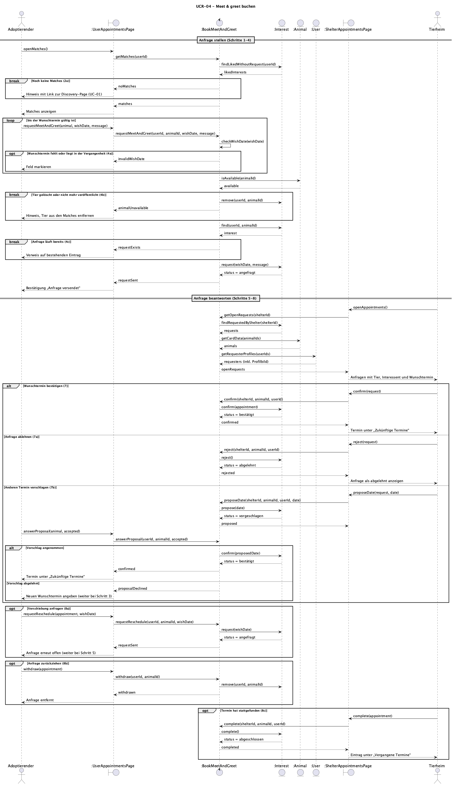
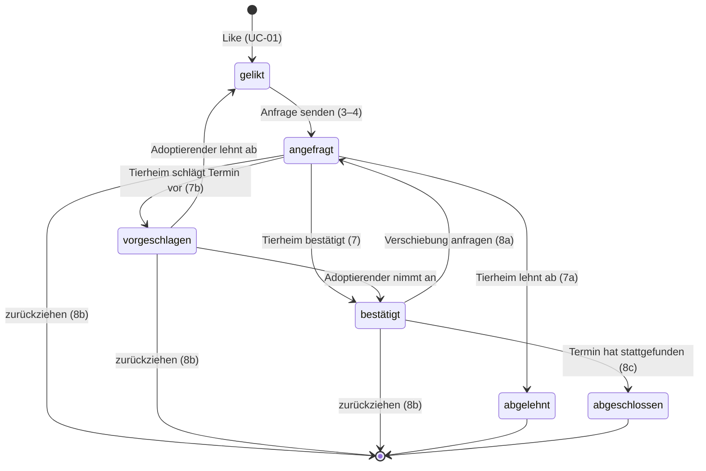

# UCR-04 Meet & greet buchen — Use-Case Realization

| Autor | Realisiert |
| ------ | -------- |
| Constantin | [UC-04 Meet & greet buchen](../use_cases/UC-04_meet_and_greet.md) |

## 1 Einleitung

Diese Realisierung beschreibt, wie UC-04 „Meet & greet buchen“ umgesetzt wird.
Sie deckt den Basisablauf (Schritte 1–8) und alle alternativen Abläufe ab: 2a (keine Matches), 4a (ungültiger Wunschtermin), 4b (Tier nicht mehr verfügbar), 4c (Anfrage existiert bereits), 7a (Ablehnung), 7b (Gegenvorschlag) sowie 8a–8c (Verschiebung, Zurückziehen, Abschluss).
Nicht Teil der Realisierung sind das Liken eines Tieres (UC-01) und die Anzeige des Tierprofils aus den vergangenen Terminen (UC-02).

## 2 Flow of events — design

### 2.1 Beteiligte Objekte

| Objekt | Stereotyp | Verantwortlichkeit |
| ------ | ---------- | -------------- |
| `:UserAppointmentsPage` | boundary | Matches- und Appointments-Seite des Adoptierenden. Nimmt Anfragen, Antworten auf Gegenvorschläge, Verschiebungen und das Zurückziehen entgegen und zeigt Matches, Termine, Bestätigungen und Hinweise an. |
| `:ShelterAppointmentsPage` | boundary | Appointments-Seite des Tierheims. Zeigt offene Anfragen mit Tier, Interessent und Wunschtermin und nimmt Bestätigung, Ablehnung, Gegenvorschlag und Abschluss entgegen. |
| `:BookMeetAndGreet` | control | Koordiniert den Use Case: prüft den Wunschtermin, die Verfügbarkeit des Tieres und bestehende Anfragen und setzt den Status der Anfrage je nach Antwort von Adoptierendem oder Tierheim. |
| `:Interest` | entity | Speichert die Beziehung zwischen Adoptierendem und Tier mit Status, Wunschtermin, Termin und Nachricht. |
| `:Animal` | entity | Speichert das Tierprofil. Liefert, ob das Tier noch existiert und veröffentlicht ist, und die Daten für die Anzeige. |
| `:User` | entity | Speichert das Profil des Adoptierenden. Liefert Name und Profilbild des Interessenten für das Tierheim. |

### 2.2 Sequenzdiagramme

### 2.3 Walkthrough

Der Adoptierende öffnet seine Matches-Seite (Schritt 1). `:UserAppointmentsPage` fragt bei `:BookMeetAndGreet` die Matches an, und das Control-Objekt liest bei `:Interest` alle gelikten Tiere ohne laufende Anfrage (Schritt 2).
Gibt es keine, zeigt die Boundary einen Hinweis mit Link zur Discovery-Page und der Use Case endet (2a).

Der Adoptierende sendet für ein Tier eine Anfrage mit Wunschtermin und optionaler Nachricht (Schritt 3). `:BookMeetAndGreet` prüft zuerst den Wunschtermin; fehlt er oder liegt er in der Vergangenheit, markiert die Boundary das Feld und der Adoptierende korrigiert ihn (4a).
Danach prüft das Control-Objekt bei `:Animal`, ob das Tier noch existiert und veröffentlicht ist. Ist das nicht der Fall, wird das Interest entfernt, die Boundary informiert den Adoptierenden und der Use Case endet (4b).
Läuft für das Tier bereits eine Anfrage, verweist die Boundary auf den bestehenden Eintrag (4c).
Sonst setzt `:Interest` den Status auf „angefragt“ und speichert Wunschtermin und Nachricht; die Boundary bestätigt den Versand (Schritt 4).

Das Tierheim öffnet seine Appointments-Seite (Schritt 5). `:BookMeetAndGreet` liest die offenen Anfragen zu den eigenen Tieren bei `:Interest` und ergänzt sie um die Tierdaten aus `:Animal` sowie Name und Profilbild aus `:User` (Schritt 6).
Bestätigt das Tierheim den Wunschtermin, wird er als Termin gespeichert und der Status auf „bestätigt“ gesetzt (Schritte 7–8). Lehnt es ab, wird der Status „abgelehnt“ (7a).
Schlägt es einen anderen Termin vor, speichert `:Interest` den Vorschlag (7b); nimmt der Adoptierende an, wird der Termin bestätigt, lehnt er ab, sendet er in Schritt 3 einen neuen Wunschtermin.

Nach der Bestätigung kann der Adoptierende eine Verschiebung anfragen; der Status geht mit dem neuen Wunschtermin zurück auf „angefragt“ und der Ablauf beginnt beim Tierheim erneut (8a). Zieht er die Anfrage zurück, wird das Interest entfernt (8b).
Hat der Termin stattgefunden, markiert das Tierheim ihn als abgeschlossen und beide Seiten sehen ihn unter „Vergangene Termine“ (8c).

### 2.4 Zustandsautomat

Das `Interest` hat einen Status mit festen Übergängen. Nur die gezeigten Übergänge sind erlaubt; alle anderen lehnt das System ab.

## 3 Abgeleitete Anforderungen

- DR-04-01 - `interestStatus` wird um `shelter_proposed` (Gegenvorschlag, 7b) und `shelter_completed` (Termin hat stattgefunden, 8c) erweitert; `shelter_accepted` steht für „bestätigt“.
- DR-04-02 - Der Wunschtermin wird wie im bestehenden Schema in `interests.appointment_at` gespeichert (Status `user_requested`); bei Bestätigung bleibt er als Termin stehen, bei einem Gegenvorschlag wird er überschrieben. Für die optionale Nachricht erhält `interests` die Spalte `message`.
- DR-04-03 - `animals` erhält ein Feld `is_published`. Eine Anfrage ist nur für existierende, veröffentlichte Tiere möglich (4b).
- DR-04-04 - Pro Adoptierendem und Tier existiert höchstens ein Interest (Primärschlüssel `animal_id`, `user_id`); eine zweite Anfrage bei Status `user_requested`, `shelter_proposed` oder `shelter_accepted` wird mit `409` abgelehnt (4c).
- DR-04-05 - Ein Tierheim darf nur Interests zu Tieren mit eigener `animal_shelter_id` lesen und ändern; die `shelterId` kommt aus dem Token, nicht aus dem Request.
- DR-04-06 - Statuswechsel sind nur entlang des Zustandsautomaten in 2.4 erlaubt; andere Übergänge werden mit `409` abgelehnt.
