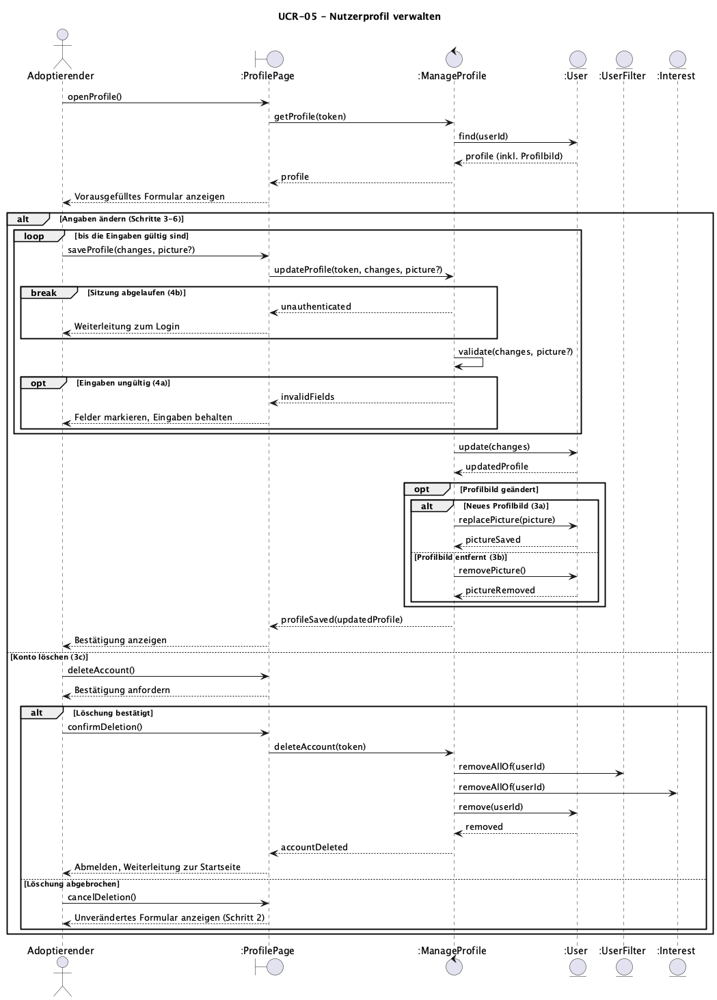

# UCR-05 Nutzerprofil verwalten — Use-Case Realization

| Autor | Realisiert |
| ------ | -------- |
| Constantin | [UC-05 Nutzerprofil verwalten](../use_cases/UC-05_manage_profile.md) |

## 1 Einleitung

Diese Realisierung beschreibt, wie UC-05 „Nutzerprofil verwalten“ umgesetzt wird.
Sie deckt den Basisablauf (Schritte 1–6) und alle alternativen Abläufe ab: 3a (Profilbild hochladen oder ersetzen), 3b (Profilbild entfernen), 3c (Konto löschen), 4a (ungültige Eingaben) und 4b (Sitzung abgelaufen).
Nicht Teil der Realisierung sind der Login, auf den bei abgelaufener Sitzung weitergeleitet wird, und die Berechnung der Tiervorschläge (UC-01), die die gespeicherten Angaben nur liest.

## 2 Flow of events — design

### 2.1 Beteiligte Objekte

| Objekt | Stereotyp | Verantwortlichkeit |
| ------ | ---------- | -------------- |
| `:ProfilePage` | boundary | Zeigt das vorausgefüllte Profilformular mit Profilbild, nimmt Änderungen, ein neues oder entferntes Profilbild und die Kontolöschung entgegen und zeigt Bestätigungen, Feldfehler und die Sicherheitsabfrage an. |
| `:ManageProfile` | control | Koordiniert den Use Case: prüft die Sitzung und die Eingaben, speichert Angaben und Profilbild und löscht bei Bestätigung das Konto mit allen zugehörigen Daten. |
| `:User` | entity | Speichert Name, Adresse, Profilbild und Wohnsituation des Adoptierenden. |
| `:UserFilter` | entity | Speichert die Filter des Adoptierenden. Wird bei der Kontolöschung mitgelöscht. |
| `:Interest` | entity | Speichert Likes und Meet-&-greet-Anfragen des Adoptierenden. Wird bei der Kontolöschung mitgelöscht. |

### 2.2 Sequenzdiagramme

### 2.3 Walkthrough

Der Adoptierende öffnet sein Profil (Schritt 1). `:ProfilePage` fragt das Profil bei `:ManageProfile` an, das Control-Objekt liest es mit der `userId` aus dem Token bei `:User`, und die Boundary zeigt das vorausgefüllte Formular mit dem aktuellen Profilbild (Schritt 2).

Ändert der Adoptierende Angaben und speichert (Schritt 3), übergibt die Boundary die Änderungen und gegebenenfalls ein neues oder entferntes Profilbild an `:ManageProfile`.
Ist die Sitzung abgelaufen, wird nichts gespeichert und die Boundary leitet zum Login weiter (4b).
Danach prüft das Control-Objekt die Eingaben (Schritt 4). Fehlt ein Pflichtfeld, ist die Postleitzahl ungültig oder das Bild zu groß oder im falschen Format, markiert die Boundary die Felder, behält die übrigen Eingaben und der Adoptierende korrigiert sie (4a).
Sind die Eingaben gültig, aktualisiert `:User` die Angaben und ersetzt (3a) oder entfernt (3b) bei Bedarf das Profilbild. Die Boundary bestätigt die Speicherung (Schritt 5); ab jetzt nutzt UC-01 die neuen Angaben (Schritt 6).

Wählt der Adoptierende „Konto löschen“ (3c), fragt die Boundary nach einer Bestätigung. Bricht er ab, bleibt alles unverändert und das Formular wird wieder angezeigt.
Bestätigt er, löscht `:ManageProfile` die Filter bei `:UserFilter`, die Likes und Anfragen bei `:Interest` und anschließend das Profil bei `:User`. Die Boundary meldet den Adoptierenden ab.

### 2.4 Zustandsautomat

Nicht zutreffend

## 3 Abgeleitete Anforderungen

- DR-05-01 - Alle Endpunkte arbeiten ausschließlich mit der `userId` aus dem Token (`req.auth.sub`), nie mit einer ID aus dem Request.
- DR-05-02 - `PATCH /users/me` validiert mit `updateUserSchema`; `email`, `isAdmin` und das Passwort können darüber nicht geändert werden.
- DR-05-03 - Profilbilder werden vor dem Speichern auf MIME-Typ (JPEG, PNG, WebP) und Größe (max. 5 MB) geprüft (NFR-UC05-01).
- DR-05-04 - Beim Löschen eines `users`-Eintrags werden `user_filters` und `interests` per `onDelete: "cascade"` in derselben Transaktion entfernt (NFR-UC05-02).
- DR-05-05 - Nach der Kontolöschung verwirft das Frontend das Token; weitere Requests mit diesem Token liefern `401`, da der Nutzer nicht mehr existiert.
