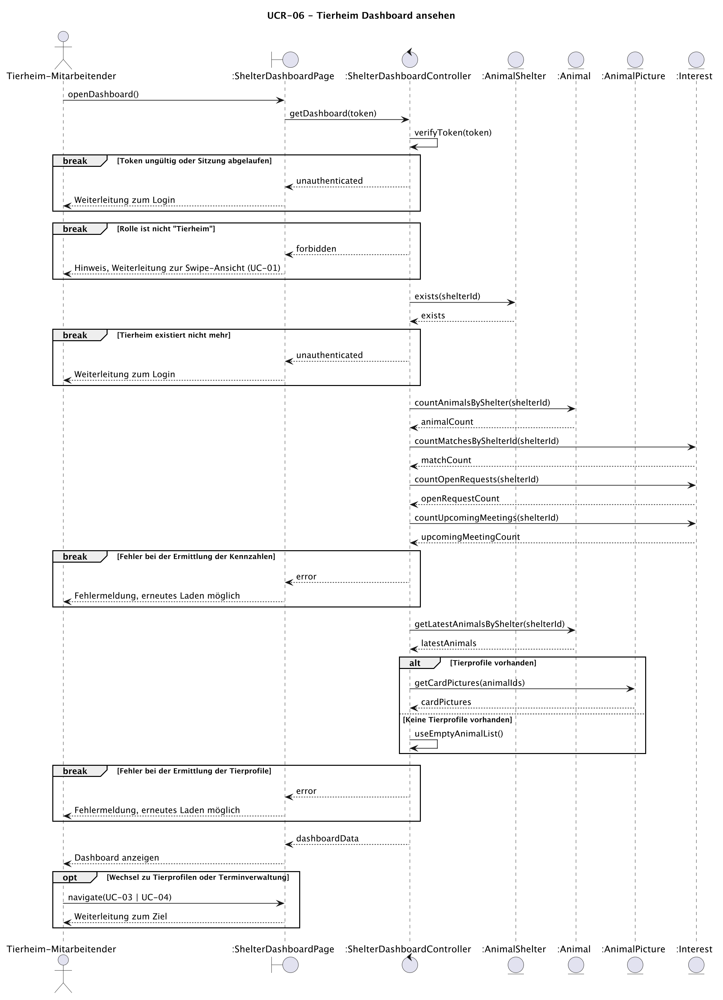

# UCR-06 Tierheim Dashboard ansehen — Use-Case Realization

<!--
HOW TO USE THIS TEMPLATE
- Copy this file per realization and name it UCR-[NN]_[name].md, with the number of its
  use case: UCR-02_book_a_room.md realizes UC-02.
- Replace every [placeholder] in square brackets.
- Stay at the analysis level from Lecture 4: boundary, control, and entity objects, no
  framework classes yet. Task 5 replaces them with your design classes.
- Delete these comments once the realization is done.
- Structure after the RUP template "Use-Case Realization Specification":
  https://cin.ufpe.br/~if682/RUP/webtmpl/templates/a_and_d/rup_ucrs.htm
  Section 2 is RUP's "Flow of Events — Design".
-->

| Autor | Realisiert |
| ------ | -------- |
| Carolin | [UC-06 Tierheim Dashboard ansehen](../use_cases/UC-06_shelter_dashboard.md) |

## 1 Einleitung

<!-- Two or three sentences: which use case this realizes, which of its flows it covers, and
     what is left out. Terms belong in the SRS, not here. -->

Diese Realisierung beschreibt, wie UC-06 "Tierheim Dashboard ansehen" umgesetzt wird.
Sie deckt den Basisablauf (Schritte 1–5) und alle alternativen Abläufe ab: 2a (nicht authentifiziert, Sitzung abgelaufen oder Tierheim existiert nicht mehr), 2b (falsche Rolle), 3a/4a (technischer Fehler) und 4b (keine Tierprofile). 
Nicht Teil der Realisierung sind der Login sowie die Seiten, auf welche der Nutzende weitergeleitet wird (UC-01, UC-03, UC-04).

## 2 Flow of events — design

### 2.1 Beteiligte Objekte

<!-- Every object in your sequence diagrams, with one responsibility each.
     Boundary: between an actor and the system — one per actor and use case;
               an external system is reached through a boundary too.
     Control:  coordinates this use case — usually one.
     Entity:   information that must be stored. -->

| Objekt | Stereotyp | Verantwortlichkeit |
| ------ | ---------- | -------------- |
| `:ShelterDashboardPage` | boundary | Nimmt den Aufruf des Dashboards vom Tierheim-Mitarbeitenden entgegen und zeigt Kennzahlen, zuletzt hinzugefügte Tierprofile, Hinweise und Fehlermeldungen an. Leitet bei Bedarf zum Login, zu UC-01, zu UC-03 oder zu UC-04 weiter. |
| `:ShelterDashboardController` | control | Koordiniert den Use Case: prüft Token und Rolle, stellt sicher, dass das Tierheim existiert, sammelt Kennzahlen und zuletzt hinzugefügte Tierprofile und gibt sie zurück. Bricht bei Fehlern ab, damit keine unvollständigen oder fremden Daten ausgeliefert werden. |
| `:AnimalShelter` | entity | Speichert den Account des Tierheims. Bestätigt, dass das Tierheim zur `shelterId` aus dem Token existiert. |
| `:Animal` | entity | Speichert die Tierprofile eines Tierheims. Liefert die Anzahl der Tierprofile und die zuletzt hinzugefügten Profile. |
| `:AnimalPicture` | entity | Speichert die Bilder eines Tieres. Liefert das Kartenbild (`showOnCard`) der zuletzt hinzugefügten Tierprofile. |
| `:Interest` | entity | Speichert die Beziehung zwischen Adoptierenden und Tier samt Status (`user_liked`, `user_disliked`, `user_requested`, `shelter_accepted`, `shelter_rejected`) und Termin. Liefert die Anzahl der Matches, anstehenden Kennenlerntermine und offenen Terminanfragen eines Tierheims. |

### 2.2 Sequenzdiagramme

<!-- The basic flow and the alternative flows: alt if a flow rejoins, break if it ends the use
     case, opt for an optional step, loop for a repeated one, ref for an included use case.
     One diagram is enough while it stays readable; otherwise one per flow.
     Commit the source file next to the image. -->

### 2.3 Walkthrough

<!-- Walk through the diagrams in a few sentences: which object does what, in which order,
     and how the diagrams fit together. Refer to the steps of the use case (1, 2, 4a …). -->

Der Tierheim-Mitarbeitende ruft das Dashboard auf (Schritt 1). `:ShelterDashboardPage` nimmt den Aufruf entgegen und fragt die Daten mit `getDashboard(token)` bei `:ShelterDashboardController` an.
Der Controller prüft zuerst das Token (Schritt 2). Ist es ungültig oder die Sitzung abgelaufen, lehnt der Controller die Anfrage ab und die Boundary leitet zum Login weiter (2a). 
Besitzt der Nutzende nicht die Rolle „Tierheim“, zeigt die Boundary einen Hinweis und leitet zur Swipe-Ansicht (UC-01) weiter (2b).
Ist die Rolle "Tierheim" und der Token gültig, fragt der Controller bei `:AnimalShelter` nach, ob das Tierheim noch existiert. 
Ist das nicht der Fall, wird zum Login weitergeleitet.
In allen drei Fehlerfällen endet der Durchlauf, ohne dass Daten abgefragt werden. 
Nach erfolgreichem Login beginnt der Use Case bei Schritt 1 von vorn.

Ist der Nutzende für das Dashboard berechtigt, ermittelt der Controller mit der `shelterId` die Kennzahlen: die Anzahl der Tierprofile bei `:Animal` sowie der Matches, der offenen Terminanfragen und der anstehenden Kennenlerntermine bei `:Interest` (Schritt 3). 
Danach fragt der Controller die zuletzt hinzugefügten Tierprofile bei `:Animal` ab (Schritt 4). 
Alle Abfragen sind auf das eigene Tierheim beschränkt. 
Gibt es Tierprofile, holt der Controller deren Kartenbilder bei `:AnimalPicture`. 
Hat das Tierheim noch keine Tierprofile (4b), bleibt der zugehörige Bereich leer, und die Kennzahlen werden trotzdem übermittelt. 
Der Controller liefert die Daten als ein Gesamtergebnis, und die Boundary stellt das Dashboard dar. 
Optional wechselt der Mitarbeitende danach zu den Tierprofilen (UC-03) oder zur Terminverwaltung (UC-04).

Tritt bei der Datenabfrage und -ermittlung ein technischer Fehler auf (3a/4a), bricht der Controller ab und liefert nur einen Fehler. 
Die Boundary zeigt eine Fehlermeldung, und der Mitarbeitende kann das Dashboard neu laden, was einem neuen Durchlauf ab Schritt 1 auslöst.

### 2.4 State machine

<!-- Optional. Only if an entity in this realization has a status with rules, e.g., a booking
     that is confirmed, canceled, or expired. Otherwise write "Not applicable". -->

Nicht zutreffend

## 3 Abgeleitete Anforderungen

<!-- Requirements the design adds and the implementation must handle, each with an ID that is
     unique in the whole SRS, e.g.,
     DR-02-01 — The slot check and the insert of the booking run in one transaction.
     DR-02-02 — The e-mails are sent asynchronously; a failed send is retried three times.
     Write "None" if there are none. -->

- DR-06-01 - Alle Abfragen des Dashboards filtern auf die `shelterId` aus dem Token, nicht auf eine ID aus dem Request. 
- DR-06-02 - Da `interests` keine Tierheim-ID enthält, werden Matches, Terminanfragen und Termine über `animals.animal_shelter_id` dem Tierheim zugeordnet.
- DR-06-03 - Kennzahlen und Tierprofile werden als ein Gesamtergebnis ausgeliefert. Tritt bei einer Abfrage ein Fehler auf, wird kein Teilergebnis zurückgegeben.
- DR-06-04 - Die Kartenbilder werden für alle angezeigten Tierprofile in einer Abfrage geladen.
- DR-06-05 - Anstehende Kennenlerntermine sind Einträge in `interests` mit Status `shelter_accepted` und `appointment_at` in der Zukunft, offene Terminanfragen haben den Status `user_requested` und Matches `user_liked`. Einträge mit `shelter_rejected` oder `user_disliked` zählen in keine Kennzahl.