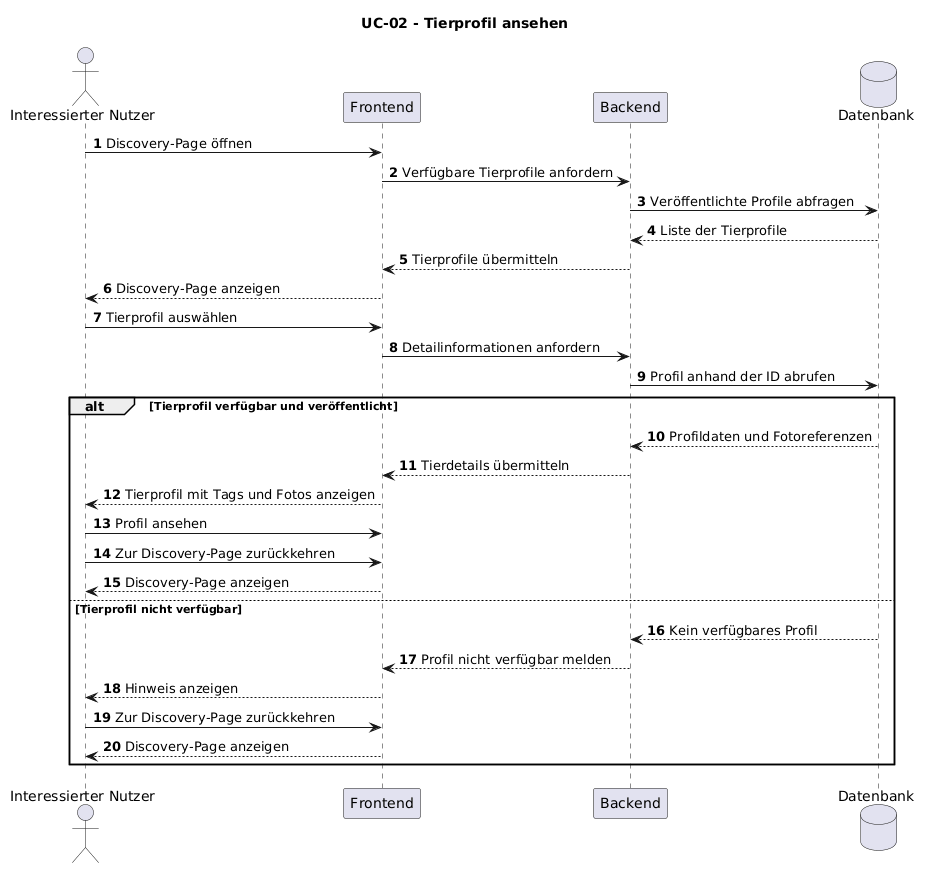

# UC-02 Tierprofil ansehen

| Autor | Schätzung | User Stories |
| ------ | -------- | ------------ |
| brdly06 | 34–55 Story Points | [#19](https://github.com/ImConsti/CoupleGOATS/issues/19) |

## 1 Kurzbeschreibung

Dieser Use Case beschreibt, wie ein Adoptierender über die Discovery-Page das Profil eines Tieres aufrufen und dessen Informationen ansehen kann. Auf jeder Tierkarte befindet sich ein Button, über den der Adoptierende zum zugehörigen Tierprofil gelangt. Das Tierprofil zeigt die Bilder, den Namen, die Tierart, die Rasse, das Alter, das Geschlecht, die Tags und die Beschreibung des Tieres sowie den Namen des zuständigen Tierheims. Über einen weiteren Button kann der Adoptierende das Profil des Tierheims aufrufen. Dadurch erhält er einen umfassenden Eindruck vom Tier und kann sich über das zuständige Tierheim informieren.

## 2 Akteure

- **Primär:** Adoptierender – möchte Informationen über ein Tier erhalten und sich über das zuständige Tierheim informieren.
- **Sekundär:** Frontend – stellt die Discovery-Page, die Tierkarten und die Detailansicht des Tierprofils dar.
- **Sekundär:** Backend – ermittelt die angeforderten Tier- und Tierheimdaten und stellt sie bereit.
- **Sekundär:** Datenbank – speichert Tierprofile und Tierheimdaten und liefert diese bei einer Anfrage zurück.
- **Sekundär:** Bildspeicher – stellt die zum Tierprofil gehörenden Bilder bereit, sofern diese separat gespeichert werden.

## 3 Mockup

## 4 Ablauf der Ereignisse

### 4.1 Basisablauf

1. Der Adoptierende öffnet die Discovery-Page.
2. Das System zeigt verfügbare, veröffentlichte Tierkarten mit den wichtigsten Informationen und gegebenenfalls einem Vorschaubild an.
3. Der Adoptierende wählt auf einer Tierkarte den Button zum Öffnen des Tierprofils aus.
4. Das Frontend fordert die Detailinformationen des ausgewählten Tieres beim Backend an.
5. Das Backend ermittelt das veröffentlichte Tierprofil sowie die zugehörigen Bilder und Informationen über das zuständige Tierheim.
6. Das Backend ruft die erforderlichen Daten aus der Datenbank ab und stellt sie dem Frontend zur Verfügung.
7. Das Frontend zeigt das Tierprofil mit Bildern, Name, Tierart, Rasse, Alter, Geschlecht, Tags und Beschreibung sowie dem Namen des zuständigen Tierheims an.
8. Das Frontend stellt einen Button bereit, über den der Adoptierende zum Profil des Tierheims wechseln kann.
9. Der Adoptierende kann das Tierprofil ansehen oder den Button zum Tierheimprofil auswählen. Bei Auswahl des Buttons wird der Adoptierende zum entsprechenden Tierheimprofil weitergeleitet.

### 4.2 Alternative Abläufe

**2a · Keine verfügbaren Tierprofile.** In Schritt 2 stellt das System fest, dass keine veröffentlichten Tierprofile verfügbar sind. Es zeigt eine entsprechende Meldung an. Der Adoptierende kann später erneut nach verfügbaren Tieren suchen. Der Use Case endet.

**3a · Tierprofil nicht mehr verfügbar.** In Schritt 3 oder 4 ist das ausgewählte Tierprofil nicht mehr verfügbar, beispielsweise weil das Tierheim es gelöscht oder unveröffentlicht hat. Das Backend stellt keine öffentlich zugänglichen Profildaten bereit. Das Frontend informiert den Adoptierenden, dass das Profil nicht mehr verfügbar ist, und ermöglicht die Rückkehr zur Discovery-Page. Der Use Case endet.

**5a · Tierprofil unvollständig oder unveröffentlicht.** In Schritt 5 stellt das Backend fest, dass das Tierprofil nicht veröffentlicht ist oder nicht mehr die Voraussetzungen für eine öffentliche Anzeige erfüllt. Das Backend verweigert die Bereitstellung der Profildaten. Das Frontend informiert den Adoptierenden, dass das Profil nicht verfügbar ist, und bietet die Rückkehr zur Discovery-Page an. Der Use Case endet.

**6a · Fehler beim Laden der Profildaten.** In Schritt 6 kann das Backend die benötigten Daten aufgrund eines technischen Fehlers nicht abrufen oder bereitstellen. Das Frontend zeigt eine verständliche Fehlermeldung an und ermöglicht einen erneuten Ladeversuch. Der Use Case endet, wenn der Adoptierende abbricht, oder wird bei einem erneuten Versuch fortgesetzt.

**7a · Bilder können nicht geladen werden.** In Schritt 7 sind die Textinformationen verfügbar, aber einzelne oder alle Bilder können nicht geladen werden. Das System zeigt die verfügbaren Profilinformationen weiterhin an und verwendet gegebenenfalls einen Platzhalter für fehlende Bilder.

**8a · Tierheimprofil nicht verfügbar.** In Schritt 9 wählt der Adoptierende den Button zum Tierheimprofil aus, aber das zugehörige Tierheimprofil kann nicht abgerufen werden oder ist nicht öffentlich verfügbar. Das System zeigt eine verständliche Meldung an. Das Tierprofil kann weiterhin betrachtet werden oder der Adoptierende kehrt zur Discovery-Page zurück.

**9a · Rückkehr zur Discovery-Page.** Der Adoptierende entscheidet sich, das Tierprofil zu verlassen, ohne das Tierheimprofil aufzurufen. Das Frontend zeigt erneut die Discovery-Page an. Der Use Case endet.

### 4.3 Sequenzdiagramm

## 5 Besondere Anforderungen

- **NFR-UC02-01 – Zugriff auf veröffentlichte Profile:** Adoptierende dürfen nur Tierprofile ansehen, die für die öffentliche Anzeige freigegeben sind.
- **NFR-UC02-02 – Vollständige Darstellung:** Das System muss die Bilder, den Namen, die Tierart, die Rasse, das Alter, das Geschlecht, die Tags und die Beschreibung des Tieres sowie den Namen des zuständigen Tierheims anzeigen, sofern die entsprechenden Angaben vorhanden sind.
- **NFR-UC02-03 – Navigation zum Tierprofil:** Jede Tierkarte auf der Discovery-Page muss einen Button besitzen, über den das zugehörige Tierprofil aufgerufen werden kann.
- **NFR-UC02-04 – Navigation zum Tierheimprofil:** Das Tierprofil muss einen Button enthalten, über den das Profil des zuständigen Tierheims aufgerufen werden kann.
- **NFR-UC02-05 – Fehlerbehandlung:** Wenn ein Tierprofil, Tierheimprofil oder Bild nicht geladen werden kann, muss das System eine verständliche Rückmeldung geben. Verfügbare Profilinformationen sollen nach Möglichkeit weiterhin angezeigt werden.
- **NFR-UC02-06 – Datenkonsistenz:** Gelöschte oder unveröffentlichte Tierprofile dürfen nicht als öffentlich verfügbare Profile angezeigt werden.
- **NFR-UC02-07 – Bedienbarkeit:** Die Navigation zwischen Discovery-Page, Tierprofil und Tierheimprofil muss für den Adoptierenden nachvollziehbar sein.

*(Konkrete Anforderungen an Ladezeiten, Barrierefreiheit und unterstützte Bildschirmgrößen müssen mit den systemweiten Anforderungen des SRS abgeglichen werden.)*

## 6 Vorbedingungen

- Die Anwendung ist erreichbar.
- Der Adoptierende kann die Discovery-Page öffnen.
- Mindestens ein Tierprofil ist veröffentlicht, damit ein Tier ausgewählt werden kann.
- Das ausgewählte Tierprofil ist öffentlich verfügbar.
- Die zugehörigen Tierprofildaten sind im System gespeichert.
- Das zuständige Tierheim ist dem Tierprofil zugeordnet.

## 7 Nachbedingungen

- **Nach erfolgreichem Ablauf:** Das Tierprofil wurde mit den verfügbaren Bildern und den vorgesehenen Informationen angezeigt.
- **Nach Auswahl des Tierheim-Buttons:** Das System leitet den Adoptierenden zum Profil des zuständigen Tierheims weiter, sofern dieses öffentlich verfügbar ist.
- **Bei einem nicht verfügbaren Tierprofil:** Das Profil wird nicht angezeigt und der Adoptierende erhält eine entsprechende Rückmeldung.
- **Bei einem Ladefehler:** Das System informiert den Adoptierenden über den Fehler. Es werden keine Tierprofil- oder Tierheimdaten verändert.
- **Nach Rückkehr zur Discovery-Page:** Der Adoptierende kann weitere veröffentlichte Tierprofile ansehen.
