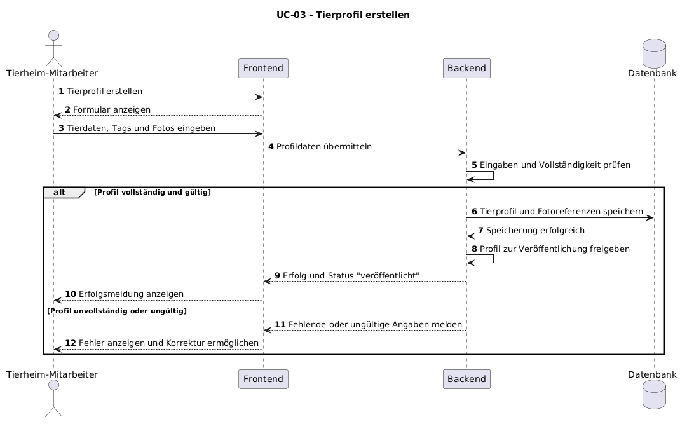
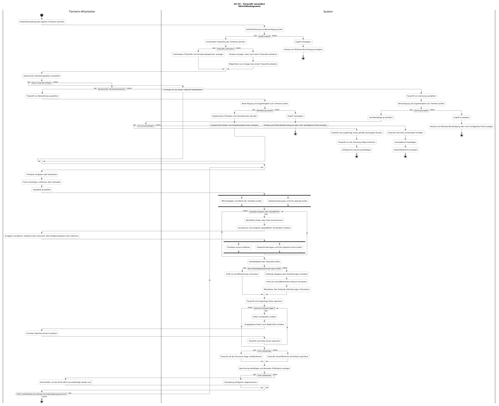

# UC-03 Tierprofil verwalten

| Autor | Schätzung | User Stories |
| ------ | -------- | ------------ |
| brdly06 | 34 – 55 Story Points | [#20](https://github.com/ImConsti/CoupleGOATS/issues/20), [#17](https://github.com/ImConsti/CoupleGOATS/issues/17), [#25](https://github.com/ImConsti/CoupleGOATS/issues/25), [#28](https://github.com/ImConsti/CoupleGOATS/issues/28), [#31](https://github.com/ImConsti/CoupleGOATS/issues/31) |

## 1 Kurzbeschreibung

Dieser Use Case beschreibt, wie ein Tierheim-Mitarbeiter Tierprofile erstellen, bearbeiten und löschen sowie die zugehörigen Fotos verwalten kann. Ein Tierprofil enthält den Namen, die Tierart, die Rasse, das Geburtsjahr, das Geschlecht, eine Beschreibung, verschiedene Tags und Fotos des Tieres. Es können mehrere Fotos hochgeladen und ein Hauptbild ausgewählt werden. Ein Tierprofil wird erst dann auf der Discovery-Page angezeigt, wenn es alle festgelegten Anforderungen an die Vollständigkeit erfüllt. Dadurch können Nutzende geeignete Tiere entdecken und sich über mögliche Adoptionen informieren.

## 2 Akteure

- **Primär:** Tierheim-Mitarbeiter – verwaltet die Tierprofile des eigenen Tierheims.
- **Sekundär:** System – prüft die eingegebenen Daten, speichert Änderungen, steuert die Sichtbarkeit der Profile und verarbeitet Löschvorgänge.
- **Sekundär:** Bildspeicher – speichert hochgeladene Fotos und stellt sie bei Bedarf bereit, sofern dieser als separater Dienst umgesetzt wird.
- **Sekundär:** Adoptierende bzw. interessierte Nutzende – betrachten veröffentlichte Tierprofile auf der Discovery-Page, sind jedoch nicht direkt an der Verwaltung beteiligt.

## 3 Mockup

## 4 Ablauf der Ereignisse

### 4.1 Basisablauf

1. Der Tierheim-Mitarbeiter ruft die Verwaltung der Tierprofile seines Tierheims auf.
2. Das System zeigt die vorhandenen Tierprofile sowie die Möglichkeit, ein neues Profil anzulegen oder ein bestehendes Profil auszuwählen.
3. Der Tierheim-Mitarbeiter entscheidet sich dafür, ein neues Tierprofil anzulegen.
4. Das System stellt ein Formular für die Angaben Name, Tierart, Rasse, Geburtsjahr, Geschlecht, Beschreibung und Tags bereit.
5. Der Tierheim-Mitarbeiter gibt die Tierdaten ein, lädt ein oder mehrere Fotos hoch und wählt ein Hauptbild aus.
6. Das System überprüft die eingegebenen Daten und die hochgeladenen Fotos und prüft, ob das Tierprofil vollständig ist.
7. Das System speichert das Tierprofil und die zugehörigen Fotos. Ist das Profil vollständig, wird es auf der Discovery-Page veröffentlicht. Andernfalls bleibt es unveröffentlicht.
8. Das System bestätigt die erfolgreiche Speicherung und zeigt den aktuellen Status des Tierprofils an.

### 4.2 Alternative Abläufe

**3a · Bestehendes Tierprofil bearbeiten.** In Schritt 3 wählt der Tierheim-Mitarbeiter ein bestehendes Tierprofil seines Tierheims aus. Das System zeigt die gespeicherten Daten an. Der Mitarbeiter ändert die gewünschten Angaben, fügt Fotos hinzu, entfernt Fotos oder wählt ein anderes Hauptbild aus. Das System überprüft die Änderungen und speichert sie. Die Sichtbarkeit des Profils wird anhand seiner Vollständigkeit aktualisiert. Der Ablauf endet mit einer Bestätigung der erfolgreichen Aktualisierung.

**3b · Tierprofil löschen.** In Schritt 3 wählt der Tierheim-Mitarbeiter ein bestehendes Tierprofil aus und fordert dessen Löschung an. Das System fordert eine Bestätigung an. Bestätigt der Mitarbeiter die Löschung, löscht das System das Tierprofil und die zugehörigen Fotos gemäß den geltenden Aufbewahrungsregeln. Das Profil wird von der Discovery-Page entfernt. Das System bestätigt die Löschung und der Use Case endet.

**3c · Löschung abbrechen.** Bei der Bestätigungsabfrage für die Löschung entscheidet sich der Tierheim-Mitarbeiter gegen die Löschung. Das System löscht weder das Tierprofil noch die zugehörigen Fotos. Der Use Case endet oder kehrt zur Übersicht der Tierprofile zurück.

**5a · Ungültige oder unvollständige Eingaben.** In Schritt 5 oder 6 fehlen erforderliche Angaben oder eingegebene Werte sind ungültig. Alternativ entspricht ein hochgeladenes Foto nicht den zulässigen Dateianforderungen. Das System weist auf die betroffenen Felder oder Dateien hin und erklärt, welche Angaben korrigiert werden müssen. Der Mitarbeiter korrigiert die Eingaben; der Ablauf wird bei Schritt 5 fortgesetzt. Ein ungültiges Profil wird nicht veröffentlicht.

**5b · Fehler beim Hochladen eines Fotos.** In Schritt 5 oder 6 kann ein Foto nicht hochgeladen oder gespeichert werden. Das System informiert den Mitarbeiter über den Fehler. Der Mitarbeiter kann den Upload erneut versuchen oder das fehlgeschlagene Foto entfernen. Falls das Foto für die Vollständigkeit erforderlich ist, bleibt das Profil unveröffentlicht, bis die fehlenden Anforderungen erfüllt sind.

**6a · Tierprofil ist unvollständig.** In Schritt 6 stellt das System fest, dass das Tierprofil nicht alle Anforderungen an die Vollständigkeit erfüllt. Sofern unvollständige Profile gespeichert werden dürfen, speichert das System das Profil als Entwurf und informiert den Mitarbeiter über die fehlenden Angaben. Der Mitarbeiter kann das Profil vervollständigen oder die Bearbeitung zu einem späteren Zeitpunkt fortsetzen. Das Profil wird erst nach Erfüllung aller Vollständigkeitsanforderungen auf der Discovery-Page angezeigt.

**2a · Noch keine Tierprofile vorhanden.** In Schritt 2 existieren für das Tierheim noch keine Tierprofile. Das System zeigt eine entsprechende Meldung an und bietet die Möglichkeit, das erste Tierprofil anzulegen. Der Ablauf wird bei Schritt 3 fortgesetzt.

**2b · Fehlende Berechtigung.** Beim Aufruf oder bei der Auswahl eines Tierprofils stellt das System fest, dass der Mitarbeiter nicht berechtigt ist, auf das angeforderte Profil zuzugreifen oder es zu verändern. Das System verweigert den Zugriff und verhindert das Auslesen oder Ändern der geschützten Daten. Der Use Case endet.

**6b · Fehler beim Speichern.** In Schritt 7 kann das System das Tierprofil oder die vorgenommenen Änderungen nicht speichern. Das System informiert den Mitarbeiter über den Fehler und erhält die eingegebenen Daten nach Möglichkeit, damit der Speichervorgang erneut versucht werden kann. Das System bestätigt weder eine erfolgreiche Speicherung noch veröffentlicht es ein nicht gespeichertes Profil.

### 4.3 Sequenzdiagramm

## 4.4 Activity diagram

Das Aktivitätsdiagramm stellt den Basisablauf und die Alternativabläufe des Use Cases UC-03 „Tierprofil verwalten“ dar. Die Swimlanes unterscheiden zwischen den Aktionen des Tierheim-Mitarbeiters und den Aktivitäten des Systems.

Der Ablauf beginnt mit dem Aufruf der Tierprofilverwaltung und der Prüfung der Berechtigung. Anschließend kann der Mitarbeiter ein neues Tierprofil anlegen, ein vorhandenes Profil bearbeiten oder ein Profil löschen. Bei der Bearbeitung und Löschung wird zusätzlich geprüft, ob das ausgewählte Profil zum zuständigen Tierheim gehört und der Mitarbeiter zur jeweiligen Aktion berechtigt ist.

Beim Erstellen und Bearbeiten werden die Tierdaten sowie die zugehörigen Fotos geprüft. Die Prüfung der Tierdaten und der Foto-Uploads ist als paralleler Ablauf mit Fork und Join dargestellt. Ungültige Eingaben und fehlgeschlagene Uploads führen zu einer Fehlermeldung und ermöglichen eine Korrektur, einen erneuten Upload oder das Entfernen eines fehlgeschlagenen Fotos.

Nach erfolgreicher Validierung prüft das System die Vollständigkeit des Tierprofils. Vollständige Profile können veröffentlicht werden; unvollständige Profile bleiben unveröffentlicht und werden als Entwurf gespeichert, sofern das Speichern erfolgreich ist. Fehlgeschlagene Speichervorgänge werden gemeldet und können erneut versucht werden. Bei der Löschung wird das Profil erst nach ausdrücklicher Bestätigung entfernt. Wird die Löschung abgebrochen, bleiben das Tierprofil und die zugehörigen Fotos erhalten.

## 5 Besondere Anforderungen

- **NFR-UC03-01 – Zugriffskontrolle:** Nur authentifizierte und für das jeweilige Tierheim autorisierte Mitarbeiter dürfen Tierprofile dieses Tierheims erstellen, anzeigen, bearbeiten oder löschen. Unberechtigte Zugriffe und Änderungen müssen abgewiesen werden.
- **NFR-UC03-02 – Datenvalidierung:** Das System muss Tierprofildaten vor der Veröffentlichung überprüfen. Ungültige oder unvollständige Profile dürfen nicht auf der Discovery-Page angezeigt werden.
- **NFR-UC03-03 – Fotoverwaltung:** Das System muss mehrere Fotos pro Tierprofil unterstützen und dem Tierheim-Mitarbeiter ermöglichen, ein Hauptbild auszuwählen.
- **NFR-UC03-04 – Sichere Löschung:** Ein Tierprofil darf erst nach einer ausdrücklichen Bestätigung durch einen berechtigten Mitarbeiter endgültig gelöscht werden.
- **NFR-UC03-05 – Konsistente Sichtbarkeit:** Nach dem Erstellen, Bearbeiten oder Löschen eines Tierprofils muss die Anzeige auf der Discovery-Page dem aktuellen Status entsprechen. Gelöschte Profile dürfen dort nicht mehr angezeigt werden.
- **NFR-UC03-06 – Fehlerrückmeldungen:** Bei ungültigen Eingaben, fehlgeschlagenen Foto-Uploads oder fehlgeschlagenen Speicher- und Löschvorgängen muss das System eine verständliche Rückmeldung geben.

*(Noch festzulegen: Konkrete Antwortzeitvorgaben, maximale Bildgröße, unterstützte Bildformate und die verbindlichen Pflichtfelder müssen mit dem Team abgestimmt werden.)*

## 6 Vorbedingungen

- Der Tierheim-Mitarbeiter ist im System angemeldet.
- Der Mitarbeiter ist berechtigt, Tierprofile seines Tierheims zu verwalten.
- Das System ist verfügbar.
- Für die Bearbeitung oder Löschung existiert das betreffende Tierprofil und es gehört zum zuständigen Tierheim.
- Für das Hochladen von Fotos steht die erforderliche Upload- und Speicherfunktion zur Verfügung.

## 7 Nachbedingungen

- **Nach erfolgreicher Erstellung:** Das Tierprofil und die zugehörigen Fotos sind gespeichert. Das Profil wird auf der Discovery-Page veröffentlicht, wenn es alle Vollständigkeitsanforderungen erfüllt. Andernfalls bleibt es unveröffentlicht.
- **Nach erfolgreicher Bearbeitung:** Das Tierprofil enthält die aktualisierten Daten und Fotos. Seine Sichtbarkeit richtet sich nach seiner Vollständigkeit.
- **Nach erfolgreicher Löschung:** Das Tierprofil wurde gemäß der Löschrichtlinie endgültig gelöscht und wird nicht mehr auf der Discovery-Page angezeigt.
- **Nach Abbruch der Löschung:** Das Tierprofil und seine Fotos bleiben unverändert erhalten.
- **Nach einem fehlgeschlagenen Vorgang:** Das System meldet keine ungültigen oder nicht gespeicherten Änderungen als erfolgreich. Bereits gespeicherte Daten bleiben unverändert, sofern der fehlgeschlagene Vorgang rückgängig gemacht werden kann.
