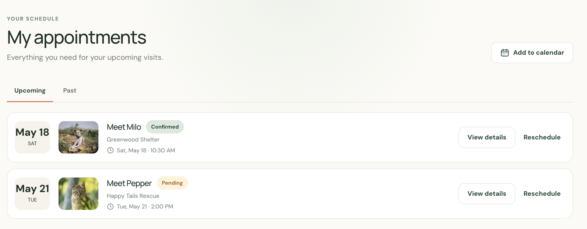
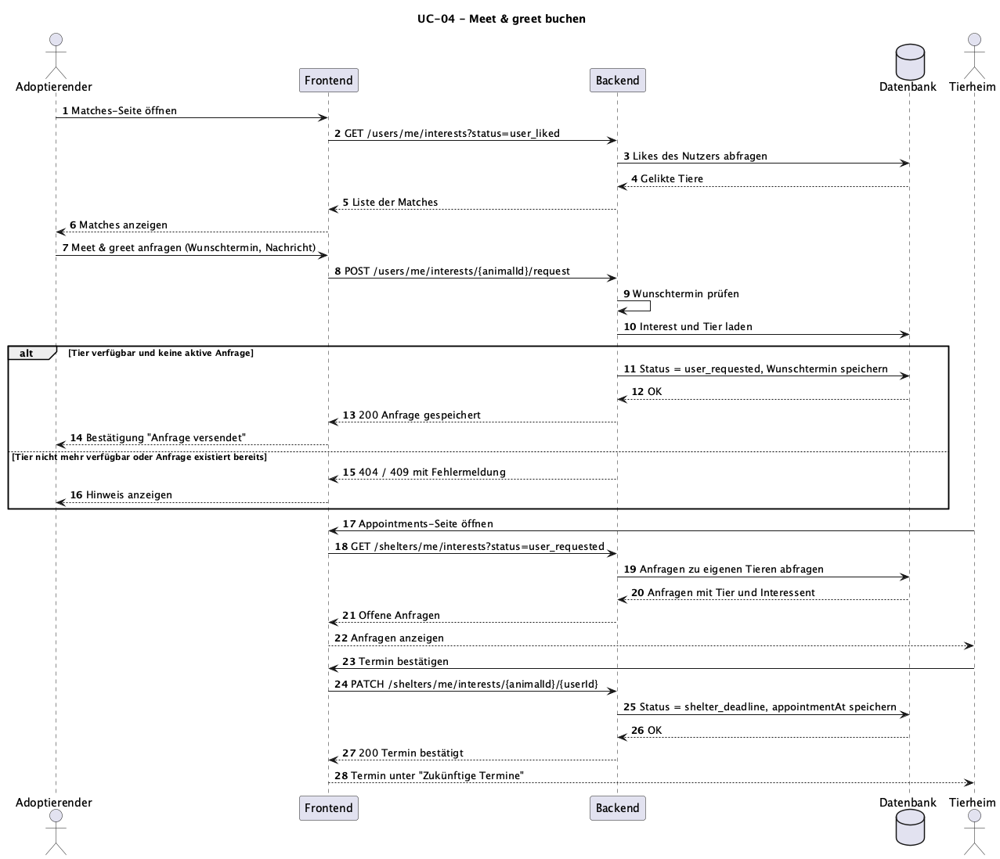

# UC-04 Meet & greet buchen

| Autor | Schätzung | User Stories |
| ------ | -------- | ------------ |
| Constantin | 21 Story Points | [#26](https://github.com/ImConsti/CoupleGOATS/issues/26), [#29](https://github.com/ImConsti/CoupleGOATS/issues/29), [#34](https://github.com/ImConsti/CoupleGOATS/issues/34), [#35](https://github.com/ImConsti/CoupleGOATS/issues/35), [#36](https://github.com/ImConsti/CoupleGOATS/issues/36) |

## 1 Kurzbeschreibung

Hat ein Adoptierender ein Tier geliked, erscheint es auf seiner Matches-Seite. Von dort aus kann er beim zuständigen Tierheim ein Meet & greet anfragen, also einen Besuchstermin, um das Tier vor einer Adoption persönlich kennenzulernen. Dazu wählt er einen Wunschtermin und kann dem Tierheim optional eine Nachricht mitschicken. Das Tierheim sieht die Anfrage auf seiner Appointments-Seite und kann sie bestätigen, ablehnen oder einen anderen Termin vorschlagen. Beide Seiten sehen auf ihrer Appointments-Seite jederzeit den aktuellen Stand ihrer offenen, bestätigten und vergangenen Termine.

## 2 Akteure

- **Primär:** Adoptierender – fragt einen Besuchstermin für ein geliktes Tier an.
- **Sekundär:** Tierheim – prüft die Anfrage und bestätigt, lehnt ab oder schlägt einen anderen Termin vor.

## 3 Mockup

## 4 Ablauf der Ereignisse

### 4.1 Basisablauf

1. Der Adoptierende öffnet seine Matches-Seite.
2. Das System zeigt alle Tiere an, die der Adoptierende geliked hat und für die noch keine Anfrage läuft.
3. Der Adoptierende wählt bei einem Tier „Meet & greet anfragen“, gibt einen Wunschtermin und optional eine Nachricht an das Tierheim ein und sendet die Anfrage ab.
4. Das System prüft den Wunschtermin, speichert die Anfrage mit dem Status „angefragt“ und bestätigt dem Adoptierenden, dass die Anfrage versendet wurde.
5. Das Tierheim öffnet seine Appointments-Seite.
6. Das System zeigt alle offenen Anfragen zu Tieren des Tierheims mit Tier, Interessent (inkl. Profilbild) und Wunschtermin an.
7. Das Tierheim bestätigt den Wunschtermin.
8. Das System speichert den Termin, setzt den Status auf „bestätigt“ und zeigt den Termin auf der Appointments-Seite beider Seiten unter „Zukünftige Termine“ an.

### 4.2 Alternative Abläufe

**2a · Noch keine Matches.** In Schritt 2 hat der Adoptierende noch kein Tier geliked. Das System zeigt einen Hinweis und einen Link zur Discovery-Page (UC-01). Der Use Case endet.

**4a · Ungültiger Wunschtermin.** In Schritt 4 liegt der Wunschtermin in der Vergangenheit oder fehlt. Das System markiert das Feld und speichert nichts. Der Ablauf geht bei Schritt 3 weiter.

**4b · Tier nicht mehr verfügbar.** In Schritt 4 wurde das Tier inzwischen vom Tierheim gelöscht oder nicht mehr veröffentlicht. Das System lehnt die Anfrage ab, informiert den Adoptierenden und entfernt das Tier von der Matches-Seite. Der Use Case endet.

**4c · Anfrage existiert bereits.** In Schritt 4 läuft für dieses Tier bereits eine Anfrage des Adoptierenden. Das System speichert keine zweite Anfrage und verweist auf den bestehenden Eintrag in der Appointments-Seite. Der Use Case endet.

**7a · Anfrage ablehnen.** In Schritt 7 lehnt das Tierheim die Anfrage ab. Das System setzt den Status auf „abgelehnt“ und zeigt das dem Adoptierenden auf seiner Appointments-Seite an. Der Use Case endet.

**7b · Anderen Termin vorschlagen.** In Schritt 7 passt dem Tierheim der Wunschtermin nicht und es schlägt einen anderen Termin vor. Das System speichert den Vorschlag und zeigt ihn dem Adoptierenden an. Nimmt der Adoptierende an, geht es bei Schritt 8 weiter. Lehnt er ab, kann er in Schritt 3 einen neuen Wunschtermin schicken.

**8a · Verschiebung anfragen.** Nach Schritt 8 kann der Adoptierende bei einem bestätigten Termin eine Verschiebung anfragen. Das System setzt den Status wieder auf „angefragt“ mit dem neuen Wunschtermin. Der Ablauf geht bei Schritt 5 weiter.

**8b · Anfrage zurückziehen.** Solange der Termin noch nicht stattgefunden hat, kann der Adoptierende seine Anfrage zurückziehen. Das System löscht die Anfrage und das Tierheim sieht sie nicht mehr. Der Use Case endet.

**8c · Termin hat stattgefunden.** Ist der Termin vorbei, markiert das Tierheim ihn als abgeschlossen. Das System verschiebt den Eintrag bei beiden Seiten nach „Vergangene Termine“. Beim Adoptierenden führt ein Klick auf den Eintrag zum Tierprofil (UC-02), solange das Tier noch existiert.

### 4.3 Sequenzdiagramm

## 5 Besondere Anforderungen

- **NFR-UC04-01 – Zugriffskontrolle:** Ein Tierheim darf nur Anfragen zu eigenen Tieren sehen und beantworten. Ein Adoptierender sieht nur seine eigenen Anfragen. Fremde Zugriffe beantwortet das Backend mit `403`.
- **NFR-UC04-02 – Aktualität:** Eine Antwort des Tierheims muss spätestens beim nächsten Laden der Appointments-Seite beim Adoptierenden sichtbar sein.
- **NFR-UC04-03 – Eine Anfrage pro Tier:** Pro Adoptierendem und Tier darf höchstens eine aktive Anfrage existieren.

## 6 Vorbedingungen

- Der Adoptierende ist angemeldet.
- Der Adoptierende hat das Tier geliked (UC-01) und das Tier ist veröffentlicht.
- Für die Schritte 5 bis 8 ist das Tierheim angemeldet, dem das Tier gehört.

## 7 Nachbedingungen

- **Nach Schritt 4:** Die Anfrage ist mit Wunschtermin und Status „angefragt“ gespeichert und erscheint beim Tierheim.
- **Nach erfolgreicher Bestätigung:** Der Termin ist gespeichert und bei beiden Seiten unter „Zukünftige Termine“ zu sehen.
- **Nach Ablehnung:** Die Anfrage hat den Status „abgelehnt“, es ist kein Termin gespeichert.
- **Nach einem Fehler:** Es wurde keine Anfrage gespeichert und das System hat keinen Erfolg gemeldet.
