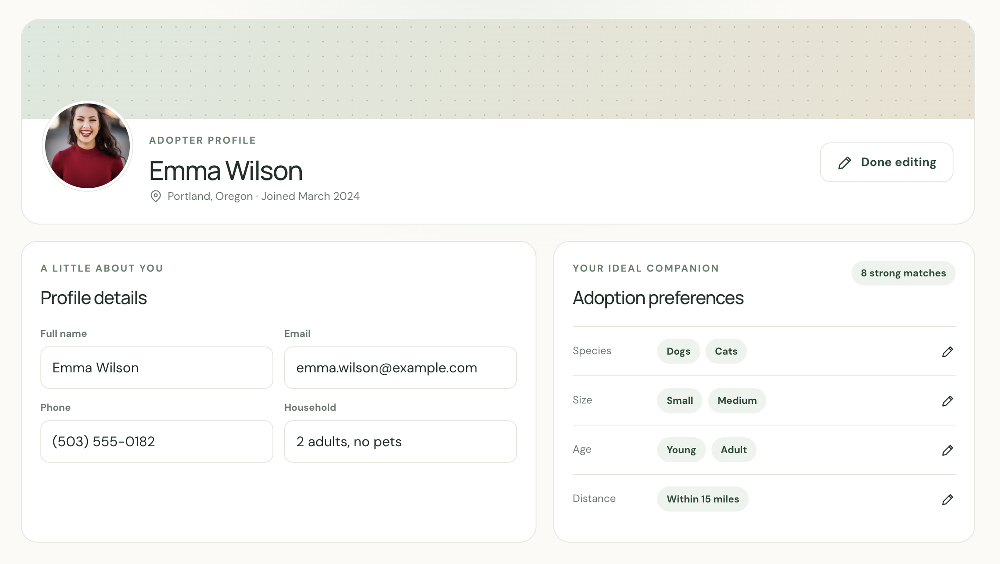
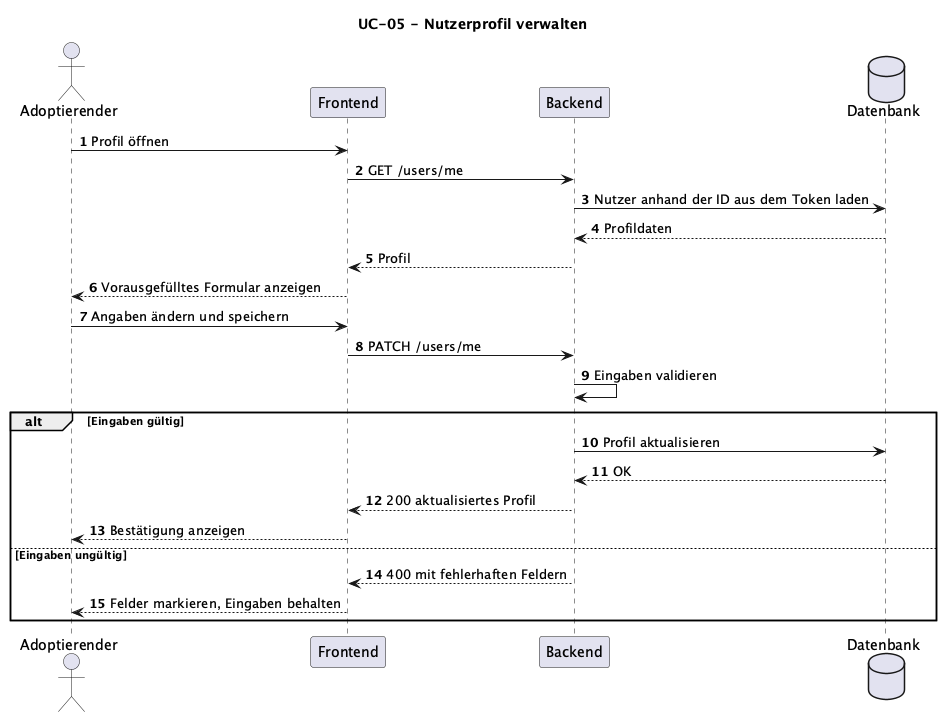
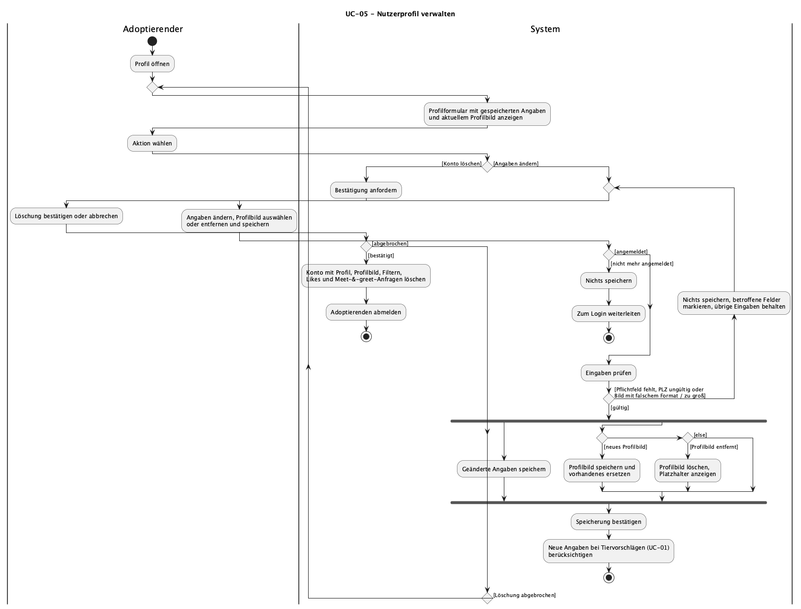

# UC-05 Nutzerprofil verwalten

| Autor | Schätzung | User Stories |
| ------ | -------- | ------------ |
| Constantin | 13 Story Points | [#15](https://github.com/ImConsti/CoupleGOATS/issues/15), [#27](https://github.com/ImConsti/CoupleGOATS/issues/27), [#30](https://github.com/ImConsti/CoupleGOATS/issues/30), [#33](https://github.com/ImConsti/CoupleGOATS/issues/33) |

Realisierung: [UCR-05](../use_case_realizations/UCR-05_manage_profile.md)

## 1 Kurzbeschreibung

Der Adoptierende kann sein Profil jederzeit ansehen und ändern. Zum Profil gehören Name, Adresse, ein Profilbild und die Angaben zur Wohnsituation: Haus oder Wohnung, Garten, Kinder im Haushalt, Raucher und ob ein Tier frei laufen kann. Diese Angaben nutzt das System, um passende Tiere vorzuschlagen, und das Tierheim sieht sie bei einer Meet-&-greet-Anfrage. Über das Profilbild erkennt das Tierheim den Adoptierenden beim Besuch. Außerdem kann der Adoptierende sein Konto hier endgültig löschen, wodurch alle seine personenbezogenen Daten entfernt werden.

## 2 Akteure

- **Primär:** Adoptierender – pflegt seine Profilangaben und sein Profilbild oder löscht sein Konto.
- **Sekundär:** keine

## 3 Mockup

## 4 Ablauf der Ereignisse

### 4.1 Basisablauf

1. Der Adoptierende öffnet über die Navigation sein Profil.
2. Das System zeigt das Profilformular, vorausgefüllt mit den gespeicherten Angaben und dem aktuellen Profilbild.
3. Der Adoptierende ändert eine oder mehrere Angaben und speichert.
4. Das System prüft die Eingaben.
5. Das System speichert die geänderten Angaben und bestätigt die Speicherung.
6. Ab jetzt berücksichtigt das System die neuen Angaben bei den Tiervorschlägen (UC-01).

### 4.2 Alternative Abläufe

**3a · Profilbild hochladen oder ersetzen.** In Schritt 3 wählt der Adoptierende ein neues Profilbild aus. Das System prüft Format und Größe, speichert das Bild und ersetzt damit ein vorhandenes. Der Ablauf geht bei Schritt 5 weiter.

**3b · Profilbild entfernen.** In Schritt 3 entfernt der Adoptierende sein Profilbild. Das System löscht das Bild und zeigt stattdessen einen Platzhalter. Der Ablauf geht bei Schritt 5 weiter.

**3c · Konto löschen.** In Schritt 3 wählt der Adoptierende „Konto löschen“. Das System fragt nach einer Bestätigung. Bestätigt der Adoptierende, löscht das System das Konto mit allen personenbezogenen Daten, also Profil, Profilbild, Filtern, Likes und Meet-&-greet-Anfragen, und meldet ihn ab. Bricht er ab, bleibt alles unverändert und der Ablauf geht bei Schritt 2 weiter.

**4a · Ungültige Eingaben.** In Schritt 4 fehlt ein Pflichtfeld, die Postleitzahl ist ungültig oder das Profilbild hat ein nicht erlaubtes Format oder ist zu groß. Das System speichert nichts, markiert die betroffenen Felder und behält die übrigen Eingaben im Formular. Der Ablauf geht bei Schritt 3 weiter.

**4b · Sitzung abgelaufen.** In Schritt 4 ist der Adoptierende nicht mehr angemeldet. Das System speichert nichts und leitet zum Login weiter. Der Use Case endet.

### 4.3 Sequenzdiagramm

### 4.4 Activity diagram

## 5 Besondere Anforderungen

- **NFR-UC05-01 – Profilbild:** Das System muss Profilbilder in den Formaten JPEG, PNG und WebP bis 5 MB annehmen und größere oder andere Dateien mit einer Fehlermeldung ablehnen.
- **NFR-UC05-02 – Vollständige Löschung:** Nach einer Kontolöschung dürfen keine personenbezogenen Daten des Adoptierenden mehr in der Datenbank stehen, und ein Login mit den alten Zugangsdaten muss scheitern.

## 6 Vorbedingungen

- Der Adoptierende hat ein Konto und ist angemeldet.

## 7 Nachbedingungen

- **Nach dem Speichern:** Die geänderten Angaben und gegebenenfalls das Profilbild sind gespeichert und werden bei den Tiervorschlägen berücksichtigt.
- **Nach der Kontolöschung:** Das Konto und alle zugehörigen Daten sind gelöscht und der Adoptierende ist abgemeldet.
- **Nach ungültigen Eingaben oder Abbruch:** Die gespeicherten Daten sind unverändert.
