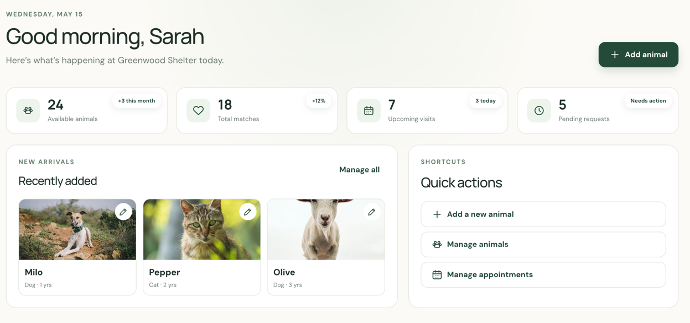
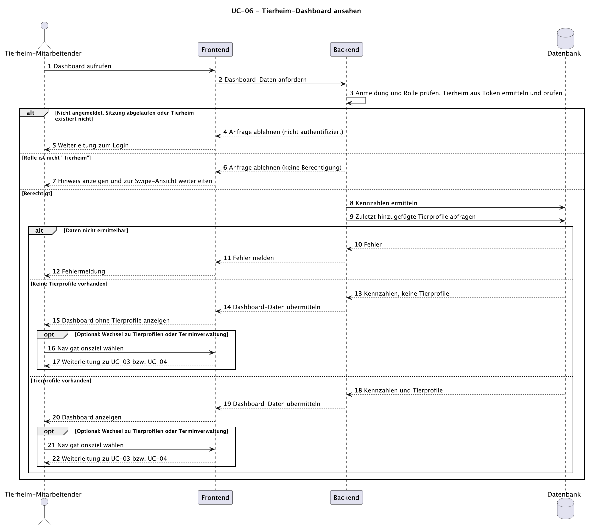
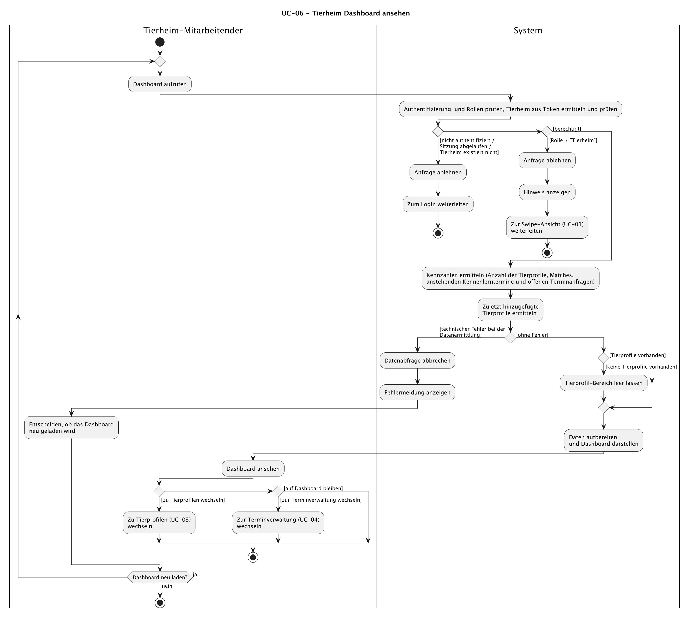

# UC-06 Tierheim Dashboard ansehen

| Author  | Estimate | User stories |
| ------- | -------- | ------------ |
| Carolin | 5 Story Points        | [#37](https://github.com/ImConsti/CoupleGOATS/issues/37)          |

Realisation: [UCR-06](../use_case_realizations/UCR-06_shelter_dashboard.md)

## 1 Kurzbeschreibung

Nach dem Login oder über die Navigation gelangen Mitarbeitende eines Tierheims auf eine zentrale Übersichtsseite. 
Sie zeigt Kennzahlen (Anzahl Tierprofile, Matches, anstehender Kennenlerntermine und offener Terminanfragen) sowie die zuletzt hinzugefügten Tierprofile. 
Von dort aus gelangen die Mitarbeitenden zur Bearbeitung eines Tierprofils, zur Übersicht über alle Tierprofile oder zum Anlegen eines neuen Tierprofils (UC-03) sowie zur Terminverwaltung (UC-04).

## 2 Akteure

- **Primär:** Tierheim-Mitarbeitende
- **Sekundär:** keine

## 3 Mockup

<!-- A wireframe is enough. Show the key step of this use case. -->

## 4 Ablauf der Ereignisse

### 4.1 Basisablauf

1. Ein Mitarbeitender des Tierheims ruft das Dashboard auf oder wird nach dem erfolgreichen Login automatisch hingeleitet.
2. Das System prüft, ob die Anfrage authentifiziert ist und der Nutzende die Rolle "Tierheim" besitzt. Das System ermittelt zudem das zugehörige Tierheim und prüft hierbei, ob das Tierheim noch existiert.
3. Das System ermittelt die Kennzahlen (Anzahl der Tierprofile, Matches, anstehender Kennenlerntermine und offener Terminanfragen).
4. Das System ermittelt die zuletzt hinzugefügten Tierprofile des Tierheims.
5. Das System liefert die aufbereiteten Daten und stellt das Dashboard dar. Von dort aus kann der Mitarbeitende optional zu den Tierprofilen (UC-03) oder zur Terminverwaltung (UC-04) wechseln. Der Use Case endet.

### 4.2 Alternative Abläufe
**2a · Nicht authentifiziert, Sitzung abgelaufen oder Tierheim existiert nicht mehr.** In Schritt 2 ist die Anfrage nicht authentifiziert, die Sitzung abgelaufen oder es wird festgestellt, dass das Tierheim nicht mehr hinterlegt ist. Das System lehnt die Anfrage ab und leitet zum Login weiter. Nach erfolgreichem Login geht es bei Schritt 1 weiter.

**2b · Falsche Rolle.** In Schritt 2 besitzt der Mitarbeitende nicht die Rolle „Tierheim“. Das System lehnt die Anfrage ab, zeigt einen Hinweis und leitet anschließend zur Swipe-Ansicht (UC-01) weiter. Der Use Case endet.

**3a / 4a · Technischer Fehler.** In Schritt 3 oder Schritt 4 tritt ein technischer Fehler bei der Ermittlung der Kennzahlen oder bei der Ermittlung der zuletzt hinzugefügten Tierprofilen auf. Das System bricht die Datenabfrage ab, zeigt eine Fehlermeldung an und stellt sicher, dass keine unvollständigen oder fremden Daten angezeigt werden. Der Mitarbeitende kann versuchen, das Dashboard erneut zu laden. Der Use Case endet, sofern die Daten nicht erfolgreich geladen werden können.

**4b · Tierheim hat noch keine Tierprofile.** In Schritt 4 stellt das System fest, dass keine Tierprofile existieren. Es lässt den Bereich der zuletzt hinzugefügten Tierprofile leer. Weiter geht es mit Schritt 5.

### 4.3 Sequenzdiagramm

<!-- The flow above over time: the actor, your frontend, your backend, your database.
     Show an alternative flow as an alt fragment where it matters.
     Commit the source file (PlantUML, draw.io, …) next to the image. -->

### 4.4 Activity diagram

## 5 besondere Anforderungen
- **NFR-UC06-01 – Performance:** Das Dashboard soll bei bis zu 200 Tierprofilen für 95 % der Aufrufe in unter 2 Sekunden vollständig geladen sein.
- **NFR-UC06-02 - Datenisolation:** Es dürfen ausschließlich Daten angezeigt werden, die sich auf das eigene Tierheim beziehen.
- **NFR-UC06-03 - Aktualität:** Die angezeigten Zahlen dürfen höchstens 60 Sekunden alt sein.

## 6 Vorbedingungen
- Die Anwendung ist erreichbar.
- Der Mitarbeitende ist angemeldet und besitzt ein gültiges Token.
- Das Tierheim hat einen Account mit der Rolle "Tierheim".

## 7 Nachbedingungen
- Das Dashboard mit den aktuellen Kennzahlen und den zuletzt hinzugefügten Tierprofilen des eigenen Tierheims wird angezeigt.
- Bei fehlender Berechtigung oder einem technischen Fehler wurden keine fremden oder unvollständigen Daten ausgeliefert.
